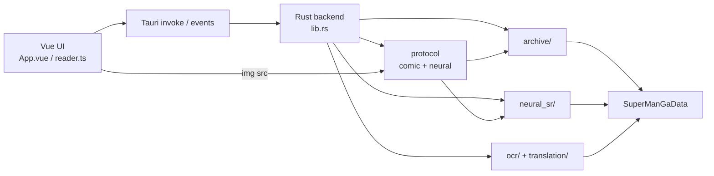
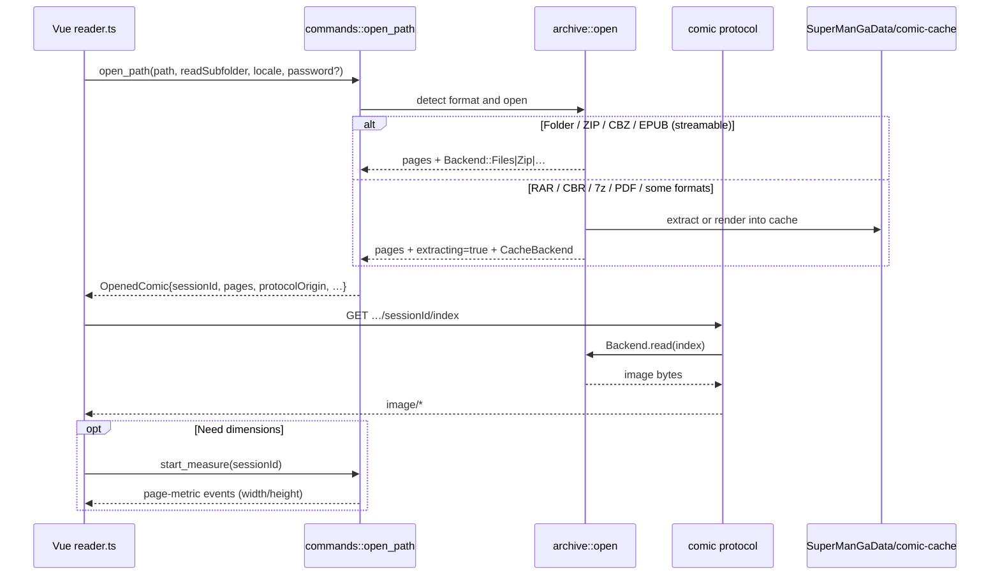
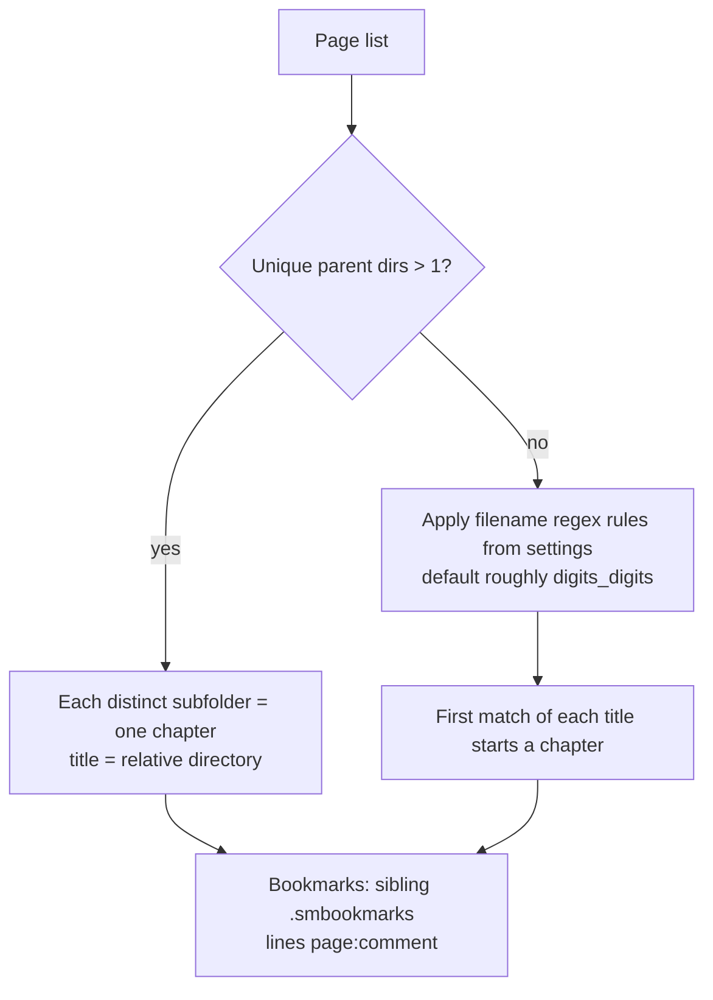
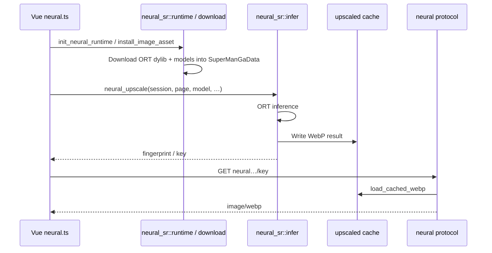
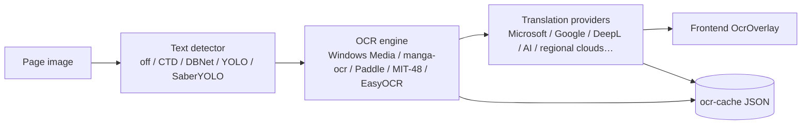

# Developer Documentation

This document is for developers and maintainers. Short install / build notes live in [README_en.md](README_en.md).

---

## Contents

1. [Overview](#1-overview)
2. [Development / Build / Release](#2-development--build--release)
3. [Directory structure](#3-directory-structure)
4. [Architecture & modules](#4-architecture--modules)
5. [Cross-platform differences](#5-cross-platform-differences)
6. [Internationalization (i18n)](#6-internationalization-i18n)
7. [Appendix: formats & licenses](#7-appendix-formats--licenses)
8. [Appendix: detector export](#8-appendix-detector-export)

---

## 1. Overview

SuperManGa is a **Vue 3 + Tauri 2** desktop app: open one folder, archive, or ebook at a time; read as a continuous vertical webtoon scroll, or as single- / double-page flips. Optional neural upscaling, bubble text detection, OCR, and online translation overlays.

| Layer | Stack |
|---|---|
| Frontend | Vue 3, Vite, TypeScript, vue-i18n |
| Desktop shell | Tauri 2, Rust |
| Native deps | pdfium (fetched per platform), ONNX Runtime (downloaded on demand), UnRAR (RAR/CBR) |

Page images are served through a custom protocol (Windows / Android: `http://comic.localhost`; elsewhere: `comic://localhost`) so archives are never converted wholesale to base64. Upscale results use the `neural` protocol the same way.

**Primary verification is on Windows.** CI also builds macOS (arm64 + x64) and Linux (x64 + arm64) packages. File associations, context menu, WebView2 checks, Windows Media OCR, and the primary-instance mutex are Windows-specific.

---

## 2. Development / Build / Release

### 2.1 Prerequisites

| Dependency | Notes |
|---|---|
| **Node.js** | Version in [`.node-version`](.node-version) (currently `22.22.2`) |
| **Rust** | Stable toolchain compatible with Tauri 2 |
| **Windows** | Visual Studio **C++ build tools**; **WebView2** Evergreen (usually present on Win10/11; portable builds check at startup and show a native prompt + Microsoft download link if missing) |
| **Linux** | `webkit2gtk-4.1` and build deps (see CI: `libwebkit2gtk-4.1-dev`, `libayatana-appindicator3-dev`, `librsvg2-dev`, `patchelf`, etc.) |
| **macOS** | Xcode CLT; system WKWebView (not WebView2) |

### 2.2 Local development

```bash
npm install
npm run fetch:pdfium   # Fetch host-platform pdfium (Win: pdfium.dll / macOS: libpdfium.dylib / Linux: libpdfium.so)
npm run dev
```

- `npm run dev` runs `predev` first (`fetch-pdfium.mjs --optional`); a failed fetch does not block.
- Encrypted / vector PDFs need pdfium; release `beforeBuildCommand` and CI fetch per target and bundle it.
- Dev server defaults to `http://localhost:1420` (`devUrl` in `tauri.conf.json`).

**Browser demo (no local files):**

```
http://localhost:1420/?demo=1
```

Uses a synthetic 24-page book to exercise the UI.

### 2.3 Local build and Windows portable package

```bash
npm run build       # all platforms: tauri build --no-bundle (no installers)
npm run build:win   # Windows: compile + portable zip
```

| Script | Role |
|---|---|
| `build` | Frontend + Rust with `--no-bundle`; **safe on any host** |
| `build:win` | Windows only: `build`, then pack `supermanga.exe` (+ pdfium) into `SuperManGa-*-windows-x64.zip` |

Windows artifact:

```
src-tauri/target/release/bundle/portable/SuperManGa-*-windows-x64.zip
```

Unpack to a folder like `SuperManGa-*-windows-x64/` containing `SuperManGa.exe` and `pdfium.dll` (when found). Release filenames stay **ASCII, no spaces**.

**CI:** the Windows job runs `npm run build:win`; macOS / Linux run `npx tauri build --bundles dmg|appimage,deb`.

On first run the app creates `SuperManGaData/` next to the exe (settings, secrets, extract/model caches). You can carry the folder with the exe on removable media; if that location is not writable, it falls back to the OS app-data directory.

### 2.4 GitHub Actions release

Workflow: [`.github/workflows/release.yml`](.github/workflows/release.yml)

1. Bump **the same version** in all three places (e.g. `0.1.1`):
   - `package.json`
   - `src-tauri/tauri.conf.json`
   - `src-tauri/Cargo.toml`
2. Commit, tag, and push:

   ```bash
   git tag v0.1.1
   git push origin v0.1.1
   ```

3. On a `v*` tag push, CI verifies the tag matches all three versions, then builds and uploads:

| Platform | Artifacts |
|---|---|
| Windows x64 | `SuperManGa-*-windows-x64.zip` (portable) |
| macOS arm64 / x64 | `.dmg` |
| Linux x64 / arm64 | `.AppImage` + `.deb` |

You can also run **Release** via `workflow_dispatch` to collect build artifacts without publishing a GitHub Release.

### 2.5 Offline full data pack (cloud-drive distribution)

For “unzip and run” without further ORT/model downloads:

```bash
npm run bundle:offline
# writes dist-offline/SuperManGaData/data/ (manifest + versioned runtime/detector/ocr/neural folders)
```

Place `SuperManGaData` next to `SuperManGa.exe` (and `pdfium.dll`) before uploading.

Assets are hosted on GitHub Release tag **`data`** (`manifest.json` + `{stem}-v{ver}.zip`). Manifest entries are `{version,bytes,sha256}`; `bytes` drives UI download size and `sha256` rejects corrupt zips after download. The app ships a seed manifest and soft-refreshes the remote manifest after startup on a short timeout (non-blocking); local layout is `SuperManGaData/data/{stem}-v{ver}/`. Build zips with [`tools/pack-data/`](tools/pack-data/).

Runtime selection:

| Machine | Behavior |
|---|---|
| Matching CUDA `runtime-cuda*-v…` | Use CUDA ORT; GPU EP when usable |
| No CUDA / no GPU pack, but `runtime-cpu-v…` present | Auto-select CPU; shows Ready |
| CUDA pack only, no CPU pack | Shows Initialize; must download CPU |

Offline packs must include the **CPU** flavor. GPU ORT zips do not ship full CUDA/cuDNN.

### 2.6 Helper scripts

| Script | Role |
|---|---|
| [`scripts/fetch-pdfium.mjs`](scripts/fetch-pdfium.mjs) | Download pdfium for the host or `PDFIUM_TARGET` / `TAURI_ENV_TARGET_TRIPLE` into `src-tauri/resources/pdfium/` |
| [`scripts/pack-portable.mjs`](scripts/pack-portable.mjs) | Pack `target/release/supermanga.exe` into a Windows portable zip (with pdfium when available) |
| [`scripts/bundle-offline-data.mjs`](scripts/bundle-offline-data.mjs) | Build multi-flavor ORT + models `SuperManGaData` (Win x64) |
| [`scripts/check-i18n.mjs`](scripts/check-i18n.mjs) | Ensure locale key parity in `src/i18n.ts` and scan for undeclared `$t` / `t(` keys |

Common npm scripts: `dev`, `fetch:pdfium`, `build`, `build:win`, `bundle:offline`, `preview`.

---

## 3. Directory structure

```
SuperManGa/
├── package.json              # name: supermanga
├── .node-version
├── DOCS_zh.md / DOCS_en.md
├── README.md
├── public/
│   └── icon.png
├── scripts/
│   ├── fetch-pdfium.mjs
│   ├── pack-portable.mjs
│   └── check-i18n.mjs
├── tools/                    # Offline tooling (not shipped in the app)
│   ├── pack-data/            # Build data Release zips + manifest
│   └── export-detectors/     # Text detectors → ONNX (for pack-data)
├── src/                      # Vue frontend
│   ├── main.ts               # Main window entry
│   ├── log-main.ts / LogApp.vue
│   ├── App.vue
│   ├── reader.ts             # Reading state, open comic, settings, shortcuts
│   ├── i18n.ts               # Five UI locales
│   ├── components/           # Reader UI, settings, OCR/neural asset dialogs, …
│   ├── composables/
│   ├── assets/
│   └── lib/
│       ├── ocr/              # Detector/engine catalogs, availability, translate queue
│       ├── render/           # Neural upscale, resample worker, texture limits
│       ├── translation/      # Provider types, defaults, fonts
│       ├── chapters.ts / chapterRules.ts / bookmarks.ts
│       └── updateCheck.ts
└── src-tauri/
    ├── tauri.conf.json       # productName: SuperManGa
    ├── Cargo.toml            # package name: supermanga
    ├── capabilities/
    ├── icons/
    ├── resources/pdfium/     # fetch output (often gitignored)
    └── src/
        ├── main.rs / lib.rs  # Entry: protocols, invoke handlers, setup
        ├── commands.rs       # open_path, bookmarks, system info, …
        ├── open.rs           # Launch args / open queue
        ├── protocol.rs       # comic / neural URI scheme handlers
        ├── state.rs
        ├── app_cache.rs      # SuperManGaData root and subdirs
        ├── secrets.rs        # Translation keys (keyring + file fallback)
        ├── instance.rs       # Primary-instance mutex (Windows)
        ├── update.rs         # GitHub Releases update check
        ├── association.rs    # File associations / context menu (Windows)
        ├── webview2_check.rs # WebView2 probe (Windows only)
        ├── window_state.rs   # Geometry restore; Windows HWND icons
        ├── system_fonts.rs
        ├── app_log.rs
        ├── ocr_assets.rs
        ├── archive/          # Folder / zip / rar / 7z / epub / pdf / mobi
        ├── data_packs.rs / neural_sr/  # data Release manifest, ORT, infer
        ├── ocr/              # Detectors + OCR engines
        └── translation/      # Online translation providers
```

---

## 4. Architecture & modules

### 4.0 Big picture



---

### A) Open-comic flow

UI invokes `open_path` → Rust picks a backend by extension → lists pages → optionally extracts / rasterizes in the background → frontend loads images via `protocol_origin` + page index. Dimensions may be filled later with `start_measure`.



**Openable:** folders; `.zip` / `.cbz`; `.rar` / `.cbr`; solid `.7z`; `.epub`; `.pdf`; DRM-free `.mobi` / `.azw3` / `.azw` (no KFX). RAR/CBR/7z/PDF extract or render into cache with progress; ready pages can be viewed early.

---

### B) Reading modes & chapters

| Mode | Behavior |
|---|---|
| `scroll` | Continuous vertical webtoon; mount images near the viewport; Up/Down scroll by configured step |
| `single` | One page at a time |
| `double` | Two-page spread; optional isolated cover; LTR / RTL; fit width / height / page |

Chapter detection (frontend [`src/lib/chapters.ts`](src/lib/chapters.ts)):



Bookmarks are read/written by Rust `load_bookmarks` / `save_bookmarks` / `delete_bookmarks` beside the comic as `.smbookmarks`.

---

### C) Neural upscale

Download ORT and model packs on demand → `neural_upscale` inference → write into `upscaled/` → frontend reads WebP via the `neural` protocol.



Modules: `neural_sr/{download,runtime,infer,cache,results,models,ort_env,cuda}`; frontend `lib/render/neural.ts`, `NeuralAssetsDialog`, `NeuralSettingsPanel`. Protocol origin: `http://neural.localhost` on Windows/Android, `neural://localhost` elsewhere.

---

### D) OCR + translation pipeline



- **Detectors** (optional aux YOLO merge, SaberYOLO OBB refine): weights downloaded from Release `data` into `SuperManGaData/data/`.
- **OCR:** Windows Media OCR is Windows-only; others are mostly ONNX and need an initialized ORT.
- **Translation:** secrets prefer the OS keyring; on failure, an app-bound encrypted file under `SuperManGaData/secrets/`.
- Frontend can pre-translate the whole book or only the current page / neighbors; results render in `OcrOverlay`.

Commands: `ocr_translate_page`, `cancel_ocr_translate`, `translate_text_cmd`.

---

### E) Settings & SuperManGaData layout

**Default root (release):** `<exe_dir>/SuperManGaData` when writable.  
**Debug / non-writable fallback:** `<OS app data>/SuperManGaData`.  
Custom path is recorded in `data-root.json` under the fixed OS app-data directory (locator always stays there).

```
SuperManGaData/
├── reader.json          # Settings / window state (plugin-store)
├── secrets/             # Translation API key file fallback
├── comic-cache/         # Archive extract / PDF render pages
├── neural-sr/           # Neural model packs
├── upscaled/            # Upscale results
├── runtime/             # ONNX Runtime libraries
├── ocr-assets/          # OCR / detector packs
├── ocr-cache/           # Per-page OCR+translation JSON
└── pdfium/              # Runtime pdfium if stored separately
```

`app_cache.rs` exposes `get_cache_dir`, `set_cache_dir`, `migrate_cache_dir`, etc. Settings UI lives in `SettingsDialog` and related panels; `reader.ts` holds the live settings object.

---

### F) Update check (primary instance only)

```mermaid
sequenceDiagram
  participant Boot as setup / reader boot
  participant INST as instance::claim_primary
  participant UI as updateCheck.ts
  participant API as update::check_app_update
  participant GH as GitHub Releases API

  Boot->>INST: claim_primary_instance()
  Note over INST: Windows: Local\\SuperManGa.PrimaryReader mutex<br/>Non-Windows: every process claims primary
  UI->>UI: is_primary_instance?
  alt Not primary
    UI-->>UI: Skip startup update probe and auto-resume last comic
  else Primary and checkUpdateOnStartup
    UI->>API: check_app_update(network)
    API->>GH: GET …/repos/ssnangua/SuperManGa/releases/latest
    GH-->>API: tag_name / html_url
    API-->>UI: UpdateCheckResult
    opt Newer release
      UI->>UI: UpdateAvailableDialog (notify only; no in-app install)
    end
  end
```

Manual “Check for updates” is not gated on primary; silent startup check and “auto-open last comic” share the primary-instance gate.

---

## 5. Cross-platform differences

| Capability | Windows | macOS | Linux | Notes |
|---|:---:|:---:|:---:|---|
| Reading core (open / navigate / chapters / bookmarks) | ✓ | ✓ | ✓ | |
| `comic` / `neural` protocols | ✓ | ✓ | ✓ | **Origins differ:** Win/Android use `http://*.localhost`; others use `scheme://localhost` |
| pdfium | ✓ | ✓ | ✓ | `fetch-pdfium` / CI per target triple |
| System font listing | ✓ | ✓ | ✓ | |
| Most OCR (manga-ocr, Paddle, MIT-48, EasyOCR) | ✓ | ✓ | ✓ | Needs ORT + asset packs |
| ORT / neural upscale | ✓ | ✓ | ✓ | CUDA etc. depend on platform/assets |
| **WebView2 startup check** | ✓ | — | — | Portable has no installer bootstrapper; exits if missing |
| **File associations / context menu** | ✓ | — | — | Registered in Settings; `association.rs` |
| **Windows Media OCR** | ✓ | — | — | `ocr/win_ocr.rs` |
| **Primary-instance mutex** | ✓ | weak | weak | Non-Win: every process reports `is_primary=true` |
| **HWND native window icons** | ✓ | — | — | `window_state::apply_native_window_icons` |
| **Portable zip script** | ✓ | — | — | `pack-portable.mjs`; mac/Linux use dmg / AppImage / deb |
| **Keyring secrets** | ✓ | ✓ | ✓ | `keyring` enables native backends; **file encryption fallback** if keyring fails (portable-friendly) |

---

## 6. Internationalization (i18n)

UI locales: `zh-CN`, `zh-TW`, `en`, `ja`, `ko` (in [`src/i18n.ts`](src/i18n.ts)). OS language tags map onto this set; unmatched tags fall back to `en`.

After editing strings, run:

```bash
node scripts/check-i18n.mjs
```

The script:

1. Checks that all five locales share the same key set;
2. Scans `src/` for `$t('…')` / `t('…')` usages missing definitions.

Translation target languages are not limited to UI locales (OCR / translation may use a wider content-language chip set).

---

## 7. Appendix: formats & licenses

### Format summary

- Folders, `.zip`, `.cbz`, `.epub`: ready to page after open; EPUB pulls spine images (fixed-layout manga style); text-heavy EPUBs with almost no images report missing art.
- `.rar`, `.cbr`, solid `.7z`, `.pdf`: extract / render into cache with progress.
- PDF: prefer local pdfium rasterization; without it, try embedded scan JPEGs; encrypted PDFs show a password dialog.
- `.mobi` / `.azw3` / `.azw`: DRM-free resource-region images; DRM is rejected explicitly. No KFX.

### UnRAR

RAR / CBR reading uses the official [unrar](https://www.rarlab.com/) decompression library (via `unrar-ng`, extract-only). UnRAR’s license terms are separate from this project’s code and must not be treated as part of the project license. See [RARLAB](https://www.rarlab.com/license.htm).

---

## 8. Appendix: detector export

Detector weights are **not** shipped in the installer. Export ONNX with [`tools/export-detectors`](tools/export-detectors) → pack with [`tools/pack-data`](tools/pack-data) into `detector-*-v*.zip` → upload Release tag **`data`**.

Requires Python 3.10+; source weights are not in this repo.

<details>
<summary>Where to get source weights</summary>

- **DBNet** (`detect-20241225.ckpt`): [detect-20241225.ckpt](https://github.com/zyddnys/manga-image-translator/releases/download/beta-0.3/detect-20241225.ckpt) from manga-image-translator. If you already have [Saber-Translator](https://github.com/MashiroSaber03/Saber-Translator) / [BallonsTranslator](https://github.com/dmMaze/BallonsTranslator), check `models/default/` or Ballons `data/models`.
- **YSGYolo** (`ysgyolo_*.pt`): Hugging Face [`YSGforMTL/YSGYoloDetector`](https://huggingface.co/YSGforMTL/YSGYoloDetector).
- **SaberYOLO** (`saber_yolo.pt`): From [Saber-Translator Releases](https://github.com/MashiroSaber03/Saber-Translator/releases) `models.zip` volumes or a full install’s `models/saber_yolo/`.
- **CTD:** `pack-data` downloads the MIT public ONNX; no local export.

</details>

```bash
cd tools/export-detectors
pip install -r requirements.txt

python export_yolo.py --weights path/to/ysgyolo_*.pt --out out/ysgyolo.onnx
python export_yolo.py --weights path/to/saber_yolo.pt --out out/saber_yolo.onnx --obb
python export_default_dbnet.py --weights path/to/detect-20241225.ckpt --out out/detect-20241225.onnx --saber-root path/to/Saber-Translator-main

cd ../pack-data
python pack.py --only detector
# Upload data/detector-*-v*.zip and manifest.json to Release tag `data`
```
