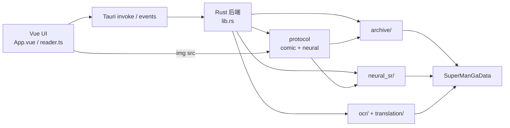
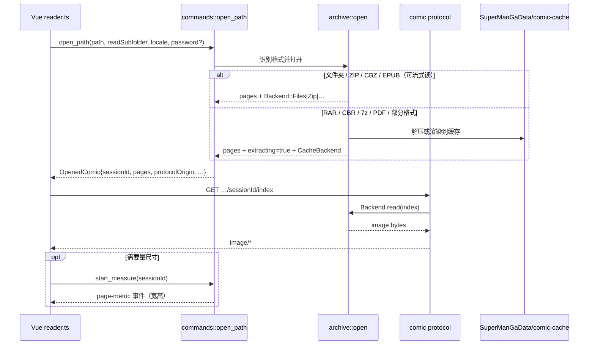
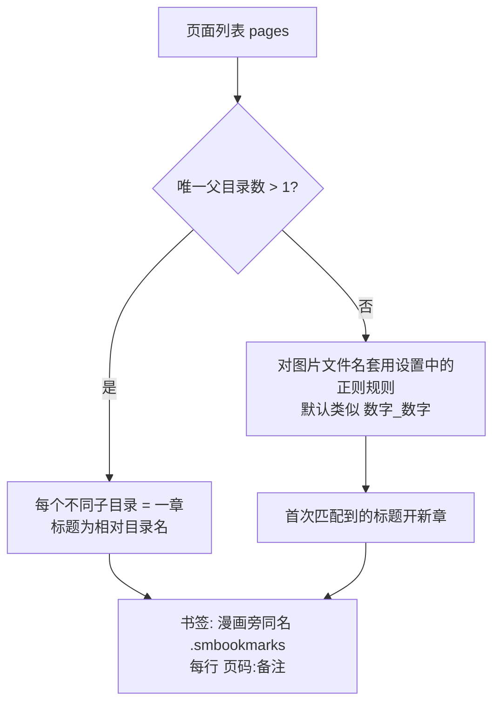
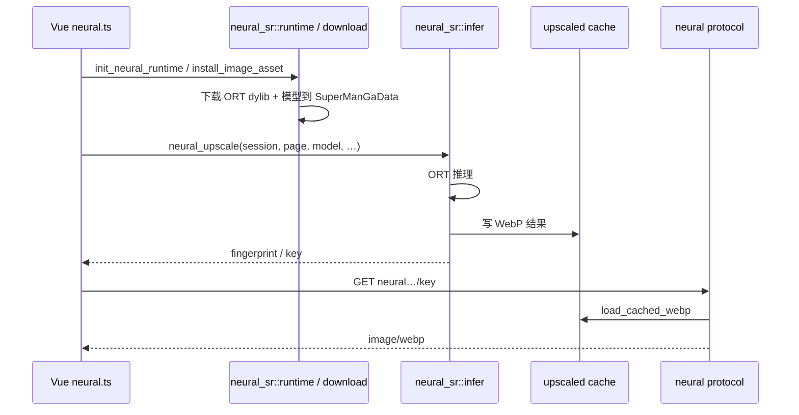
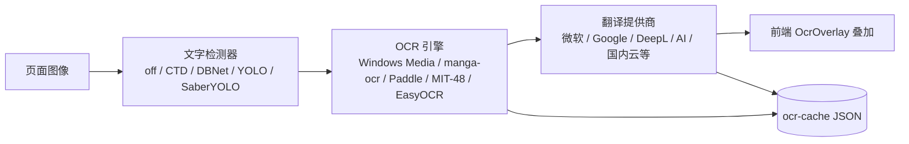
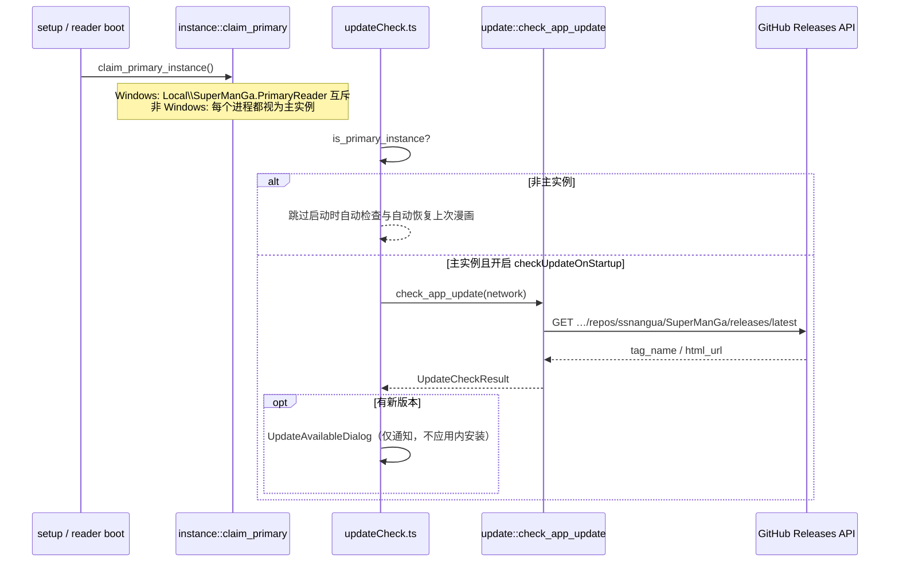

# 开发文档

本文面向开发与维护。用户向安装说明见 [README.md](README.md)。

---

## 目录

1. [概述](#1-概述)
2. [开发 / 构建 / 发布](#2-开发--构建--发布)
3. [目录结构](#3-目录结构)
4. [架构与模块](#4-架构与模块)
5. [跨平台差异](#5-跨平台差异)
6. [国际化（i18n）](#6-国际化i18n)
7. [附录：格式支持与许可](#7-附录格式支持与许可)
8. [附录：文字检测器导出](#8-附录文字检测器导出)

---

## 1. 概述

SuperManGa 是 **Vue 3 + Tauri 2** 的桌面应用：一次打开一个文件夹、压缩包或电子书，按条漫纵向滚动，或单页 / 双页翻页；可选神经网络超分、气泡文字检测、OCR 与在线翻译叠层。

| 层 | 技术 |
|---|---|
| 前端 | Vue 3、Vite、TypeScript、vue-i18n |
| 桌面壳 | Tauri 2、Rust |
| 原生依赖 | pdfium（按平台拉取）、ONNX Runtime（按需下载）、UnRAR（RAR/CBR） |

图片通过自定义协议按页返回（Windows / Android：`http://comic.localhost`；其他平台：`comic://localhost`），不会整包转成 base64。超分结果同理走 `neural` 协议。

**验证重点在 Windows**；CI 额外构建 macOS（arm64 + x64）与 Linux（x64 + arm64）安装包。文件关联、右键菜单、WebView2 检测、Windows Media OCR、进程互斥等为 Windows 专用能力。

---

## 2. 开发 / 构建 / 发布

### 2.1 前置条件

| 依赖 | 说明 |
|---|---|
| **Node.js** | 版本见仓库根目录 [`.node-version`](.node-version)（当前为 `22.22.2`） |
| **Rust** | stable 工具链；与 Tauri 2 兼容 |
| **Windows** | Visual Studio **C++ 生成工具**；**WebView2** Evergreen（Win10/11 通常已带；便携版启动前会检测，缺失则原生提示并打开微软下载页） |
| **Linux** | `webkit2gtk-4.1` 及构建依赖（见 CI：`libwebkit2gtk-4.1-dev`、`libayatana-appindicator3-dev`、`librsvg2-dev`、`patchelf` 等） |
| **macOS** | Xcode CLT；使用系统 WKWebView（非 WebView2） |

### 2.2 本地开发

```bash
npm install
npm run fetch:pdfium   # 下载本机平台 pdfium（Win: pdfium.dll / macOS: libpdfium.dylib / Linux: libpdfium.so）
npm run dev
```

- `npm run dev` 会先跑 `predev`（`fetch-pdfium.mjs --optional`），拉取失败不阻断。
- 加密 PDF / 矢量 PDF 依赖 pdfium；发版时 `beforeBuildCommand` 与 CI 会按目标平台拉取并打进包。
- 开发服务器默认 `http://localhost:1420`（见 `tauri.conf.json` 的 `devUrl`）。

**浏览器演示（不读本地文件）：**

```
http://localhost:1420/?demo=1
```

用程序生成的 24 页演示界面与阅读交互。

### 2.3 本机构建与 Windows 便携包

```bash
npm run build       # 各平台：tauri build --no-bundle（不打安装包）
npm run build:win   # Windows：编译 + 打 portable zip
```

| 命令 | 作用 |
|---|---|
| `build` | 编译前端 + Rust，`--no-bundle`，**跨平台可用** |
| `build:win` | 仅 Windows：`build` 后再把 `supermanga.exe`（+ pdfium）打进 `SuperManGa-*-windows-x64.zip` |

Windows 产物：

```
src-tauri/target/release/bundle/portable/SuperManGa-*-windows-x64.zip
```

解压后目录形如 `SuperManGa-*-windows-x64/`，内含 `SuperManGa.exe` 与 `pdfium.dll`（若已找到）。发布文件名保持 **ASCII、无空格**。

**CI**：Windows job 跑 `npm run build:win`；macOS / Linux 跑 `npx tauri build --bundles dmg|deb`。

首次运行在 exe 同级创建 `SuperManGaData/`（设置、密钥、解压与模型缓存）。可与 exe 一起放在 U 盘 / 移动硬盘上带走；若该位置不可写，则回退到系统应用数据目录。

### 2.4 GitHub Actions 发版

工作流：[`.github/workflows/release.yml`](.github/workflows/release.yml)

1. 将下列三处 **version 改成同一版本**（例如 `0.1.1`）：
   - `package.json`
   - `src-tauri/tauri.conf.json`
   - `src-tauri/Cargo.toml`
2. 提交后打 tag 并推送：

   ```bash
   git tag v0.1.1
   git push origin v0.1.1
   ```

3. 推送 `v*` tag 时，CI 校验 tag 与三处版本一致，再分别构建并上传产物：

| 平台 | 产物 |
|---|---|
| Windows x64 | `SuperManGa-*-windows-x64.zip`（portable） |
| macOS arm64 | `SuperManGa-*-macos-arm64.dmg` |
| macOS x64 | `SuperManGa-*-macos-x64.dmg` |
| Linux arm64 | `SuperManGa-*-linux-arm64.deb` |
| Linux x64 | `SuperManGa-*-linux-x64.deb` |

也可在 Actions 里 `workflow_dispatch` 手动跑 **Release**，只拿构建产物、不发 GitHub Release。

### 2.5 离线完整数据包（网盘分发）

若希望用户解压即用、不必再下 ORT / 模型：

```bash
npm run bundle:offline
# 产出 dist-offline/SuperManGaData/data/（manifest + runtime/detector/ocr/neural 版本目录）
```

将 `SuperManGaData` 与 `SuperManGa.exe`（及 `pdfium.dll`）放在同级后打包上传即可。

资源统一放在 GitHub Release tag **`data`**（`manifest.json` + `{stem}-v{ver}.zip`）。清单条目为 `{version,bytes,sha256}`；`bytes` 供界面显示下载大小，`sha256` 在下载后校验坏包。应用内置 seed 清单，启动后后台短超时静默刷新远程 `manifest.json`（不阻塞界面）；本机目录为 `SuperManGaData/data/{stem}-v{ver}/`。打 zip 可用 [`tools/pack-data/`](tools/pack-data/)。

运行时选型：

| 本机条件 | 行为 |
|---|---|
| 有匹配 CUDA 的 `runtime-cuda*-v…` | 选用 CUDA ORT，可用则走 GPU EP |
| 无 CUDA / 无 GPU 包，但有 `runtime-cpu-v…` | 自动选用 CPU，显示已就绪 |
| 只有 CUDA 包、没有 CPU 包 | 显示「初始化」，需下载 CPU 包 |

完整离线包须带上 **CPU** flavor。ORT GPU 包不含完整 CUDA/cuDNN。

### 2.6 辅助脚本

| 脚本 | 作用 |
|---|---|
| [`scripts/fetch-pdfium.mjs`](scripts/fetch-pdfium.mjs) | 按本机或 `PDFIUM_TARGET` / `TAURI_ENV_TARGET_TRIPLE` 下载 pdfium 到 `src-tauri/resources/pdfium/` |
| [`scripts/pack-portable.mjs`](scripts/pack-portable.mjs) | 将 `target/release/supermanga.exe` 打成 Windows portable zip，并附带 pdfium |
| [`scripts/bundle-offline-data.mjs`](scripts/bundle-offline-data.mjs) | 生成含多 flavor ORT + 模型的 `SuperManGaData`（Win x64） |
| [`scripts/check-i18n.mjs`](scripts/check-i18n.mjs) | 检查 `src/i18n.ts` 各语言键一致，并扫描源码中未声明的 `$t` / `t(` 键 |

常用 npm scripts：`dev`、`fetch:pdfium`、`build`、`build:win`、`bundle:offline`、`preview`。

---

## 3. 目录结构

```
SuperManGa/
├── package.json              # name: supermanga
├── .node-version
├── DOCS_zh.md / DOCS_en.md
├── README.md
├── public/
│   └── icon.png
├── scripts/
│   ├── fetch-pdfium.mjs
│   ├── pack-portable.mjs
│   └── check-i18n.mjs
├── tools/                    # 离线工具（不打进安装包）
│   ├── pack-data/            # 打 data Release zip + manifest
│   └── export-detectors/     # 文字检测器 → ONNX（供 pack-data）
├── src/                      # Vue 前端
│   ├── main.ts               # 主窗口入口
│   ├── log-main.ts / LogApp.vue
│   ├── App.vue
│   ├── reader.ts             # 阅读状态、打开漫画、设置、快捷键等核心逻辑
│   ├── i18n.ts               # 五语言文案
│   ├── components/           # UI（阅读视图、设置、OCR/神经资源对话框等）
│   ├── composables/
│   ├── assets/
│   └── lib/
│       ├── ocr/              # 检测器/引擎 catalog、可用性、翻译队列
│       ├── render/           # 神经超分、重采样 worker、纹理限制等
│       ├── translation/      # 翻译提供商类型、默认值、字体
│       ├── chapters.ts / chapterRules.ts / bookmarks.ts
│       └── updateCheck.ts
└── src-tauri/
    ├── tauri.conf.json       # productName: SuperManGa
    ├── Cargo.toml            # package name: supermanga
    ├── capabilities/
    ├── icons/
    ├── resources/pdfium/     # fetch 产物（gitignore 常见）
    └── src/
        ├── main.rs / lib.rs  # 入口：协议注册、invoke、setup
        ├── commands.rs       # open_path、书签、系统信息等
        ├── open.rs           # 启动参数 / 打开队列
        ├── protocol.rs       # comic / neural URI scheme 响应
        ├── state.rs
        ├── app_cache.rs      # SuperManGaData 根路径与子目录
        ├── secrets.rs        # 翻译密钥（keyring + 文件回退）
        ├── instance.rs       # 主实例互斥（Windows）
        ├── update.rs         # GitHub Releases 更新检查
        ├── association.rs    # 文件关联 / 右键菜单（Windows）
        ├── webview2_check.rs # WebView2 检测（Windows only）
        ├── window_state.rs   # 窗口几何恢复；Windows HWND 图标
        ├── system_fonts.rs
        ├── app_log.rs
        ├── ocr_assets.rs
        ├── archive/          # 文件夹 / zip / rar / 7z / epub / pdf / mobi
        ├── data_packs.rs / neural_sr/  # data Release 清单、ORT、推理
        ├── ocr/              # 检测器 + 各 OCR 引擎
        └── translation/      # 在线翻译提供商
```

---

## 4. 架构与模块

### 4.0 总览



---

### A) 打开漫画流程

UI 调用 `open_path` → Rust 按扩展名选择 backend → 列出页面 → 必要时后台解压 / 栅格化 → 前端用 `protocol_origin` + 页索引加载图片。尺寸可异步 `start_measure` 补全。



**支持打开：** 文件夹；`.zip` / `.cbz`；`.rar` / `.cbr`；实体 `.7z`；`.epub`；`.pdf`；无 DRM 的 `.mobi` / `.azw3` / `.azw`（不支持 KFX）。RAR/CBR/7z/PDF 等会解到或渲染到本地缓存，并上报解压进度；已就绪的页可先看。

---

### B) 阅读模式与章节

| 模式 | 说明 |
|---|---|
| `scroll` | 条漫纵向连续滚动；视口附近挂图；方向键上下按步长滚动 |
| `single` | 单页翻页 |
| `double` | 双页；可隔离封面；LTR / RTL；适应宽 / 高 / 整页 |

章节划分（前端 [`src/lib/chapters.ts`](src/lib/chapters.ts)）：



书签由 Rust `load_bookmarks` / `save_bookmarks` / `delete_bookmarks` 读写漫画路径旁的 `.smbookmarks` 文件。

---

### C) 神经超分（Neural SR）

按需下载 ONNX Runtime 与模型包 → `neural_upscale` 推理 → 结果写入 `upscaled/` → 前端通过 `neural` 协议读 WebP 缓存。



相关模块：`neural_sr/{download,runtime,infer,cache,results,models,ort_env,cuda}`；前端 `lib/render/neural.ts`、`NeuralAssetsDialog`、`NeuralSettingsPanel`。协议 origin：Windows/Android 为 `http://neural.localhost`，其余为 `neural://localhost`。

---

### D) OCR + 翻译管线



- **检测器**（可选辅 YOLO 合并、SaberYOLO OBB 精修）：权重按清单从 Release `data` 下载到 `SuperManGaData/data/`。
- **OCR**：Windows Media OCR 仅 Windows；其余多为 ONNX，依赖已初始化的 ORT。
- **翻译**：密钥优先 OS keyring，失败则写入 `SuperManGaData/secrets/` 应用绑定加密文件。
- 前端可开启「全书预翻译」或仅当前页/邻页；结果叠在 `OcrOverlay`。

入口命令：`ocr_translate_page`、`cancel_ocr_translate`、`translate_text_cmd`。

---

### E) 设置与 SuperManGaData 布局

**默认根目录（release）：** `<exe 目录>/SuperManGaData`（可写时）。  
**调试 / 不可写回退：** `<OS app data>/SuperManGaData`。  
自定义路径记录在系统 app data 下的 `data-root.json`（定位器始终在固定 OS 目录）。

```
SuperManGaData/
├── reader.json          # 设置 / 窗口状态（plugin-store）
├── secrets/             # 翻译 API 密钥文件回退
├── comic-cache/         # 压缩包解压 / PDF 渲染页
├── neural-sr/           # 神经模型包
├── upscaled/            # 超分结果
├── runtime/             # ONNX Runtime 动态库
├── ocr-assets/          # OCR / 检测器模型包
├── ocr-cache/           # 每页 OCR+翻译 JSON
└── pdfium/              # 运行时可用的 pdfium（若单独存放）
```

`app_cache.rs` 提供 `get_cache_dir`、`set_cache_dir`、`migrate_cache_dir` 等。设置 UI 在 `SettingsDialog` 等组件；`reader.ts` 持有运行时 settings 对象。

---

### F) 更新检查（仅主实例）



手动「检查更新」不强制主实例门闩；启动静默检查与「自动打开上次漫画」共用主实例门闩。

---

## 5. 跨平台差异

| 能力 | Windows | macOS | Linux | 备注 |
|---|:---:|:---:|:---:|---|
| 阅读核心（打开 / 翻页 / 章节 / 书签） | ✓ | ✓ | ✓ | |
| `comic` / `neural` 协议 | ✓ | ✓ | ✓ | **Origin 不同**：Win/Android 为 `http://*.localhost`；其他为 `scheme://localhost` |
| pdfium | ✓ | ✓ | ✓ | `fetch-pdfium` / CI 按目标 triple 拉取 |
| 系统字体列表 | ✓ | ✓ | ✓ | |
| 多数 OCR（manga-ocr、Paddle、MIT-48、EasyOCR） | ✓ | ✓ | ✓ | 需 ORT + 资源包 |
| ORT / 神经超分 | ✓ | ✓ | ✓ | CUDA 等视平台与资源 |
| **WebView2 启动检测** | ✓ | — | — | 便携版无安装器引导；缺失则退出 |
| **文件关联 / 右键菜单** | ✓ | — | — | 设置内注册；`association.rs` |
| **Windows Media OCR** | ✓ | — | — | `ocr/win_ocr.rs` |
| **主实例互斥** | ✓ | 弱 | 弱 | 非 Win：每进程都 `is_primary=true` |
| **HWND 原生窗口图标** | ✓ | — | — | `window_state::apply_native_window_icons` |
| **portable zip 脚本** | ✓ | — | — | `pack-portable.mjs`；mac/Linux 用 dmg / deb |
| **keyring 密钥** | ✓ | ✓ | ✓ | `keyring` 启用各平台原生后端；失败则 **文件加密回退**（便携可复制） |

---

## 6. 国际化（i18n）

界面语言：`zh-CN`、`zh-TW`、`en`、`ja`、`ko`（定义于 [`src/i18n.ts`](src/i18n.ts)）。系统语言标签会映射到上述集合，无法匹配时回退 `en`。

修改文案后请运行：

```bash
node scripts/check-i18n.mjs
```

脚本会：

1. 校验五种 locale 的 key 集合一致；
2. 扫描 `src/` 中 `$t('…')` / `t('…')` 是否都有定义。

翻译目标语言列表与 UI locale 不完全相同（OCR / 翻译可选用更多内容语言标签）。

---

## 7. 附录：格式支持与许可

### 阅读格式摘要

- 文件夹、`.zip`、`.cbz`、`.epub`：打开即可翻页；EPUB 按 spine 抽图（偏固定版式漫画），几乎无图的文字 EPUB 会提示找不到图片。
- `.rar`、`.cbr`、实体 `.7z`、`.pdf`：解压 / 渲染到缓存并显示进度。
- PDF：优先本机 pdfium 栅格化；缺失时尝试抽扫描 JPEG；加密 PDF 弹密码框。
- `.mobi` / `.azw3` / `.azw`：无 DRM 按资源区抽图；有 DRM 明确拒绝。不支持 KFX。

### UnRAR

读取 RAR / CBR 时使用 [unrar](https://www.rarlab.com/) 官方解压库（经 `unrar-ng`，仅解压）。UnRAR 许可条件与本项目代码分开，不能视为项目许可证的一部分。说明见 [RARLAB](https://www.rarlab.com/license.htm)。

---

## 8. 附录：文字检测器导出

检测器权重**不打进安装包**。用 [`tools/export-detectors`](tools/export-detectors) 导出 ONNX → [`tools/pack-data`](tools/pack-data) 打成 `detector-*-v*.zip` → 上传 Release tag **`data`**。

需要 Python 3.10+；源权重本仓库不收录。

<details>
<summary>如何取得源权重</summary>

- **DBNet**（`detect-20241225.ckpt`）：可从 manga-image-translator 下载 [detect-20241225.ckpt](https://github.com/zyddnys/manga-image-translator/releases/download/beta-0.3/detect-20241225.ckpt)。若已安装 [Saber-Translator](https://github.com/MashiroSaber03/Saber-Translator) / [BallonsTranslator](https://github.com/dmMaze/BallonsTranslator)，通常在 `models/default/` 或 Ballons 的 `data/models`。
- **YSGYolo**（`ysgyolo_*.pt`）：Hugging Face [`YSGforMTL/YSGYoloDetector`](https://huggingface.co/YSGforMTL/YSGYoloDetector)。
- **SaberYOLO**（`saber_yolo.pt`）：从 [Saber-Translator Releases](https://github.com/MashiroSaber03/Saber-Translator/releases) 的 `models.zip` 分卷或完整安装包的 `models/saber_yolo/` 取得。
- **CTD**：`pack-data` 直接下载 MIT 公开 ONNX，无需本地导出。

</details>

```bash
cd tools/export-detectors
pip install -r requirements.txt

python export_yolo.py --weights path/to/ysgyolo_*.pt --out out/ysgyolo.onnx
python export_yolo.py --weights path/to/saber_yolo.pt --out out/saber_yolo.onnx --obb
python export_default_dbnet.py --weights path/to/detect-20241225.ckpt --out out/detect-20241225.onnx --saber-root path/to/Saber-Translator-main

cd ../pack-data
python pack.py --only detector
# 将 data/detector-*-v*.zip 与 manifest.json 上传到 Release tag `data`
```
