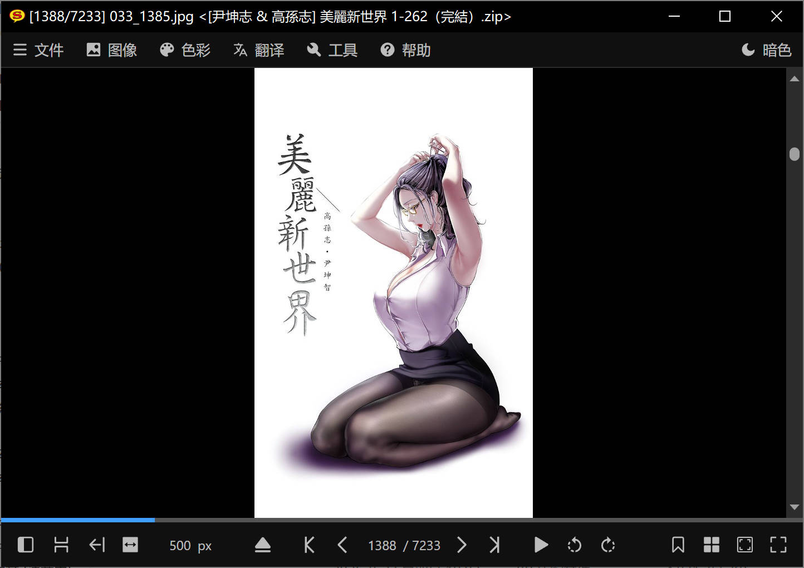

<h1>
  <p align="center">
    <br />SuperManGa
  </p>
</h1>


<p align="center">
  
  
  
</p>

<p align="center">
  <strong>一个简单实用的本地漫画阅读器</strong>
</p>
<p align="center">
单页 / 双页 / 条漫滚动 · 图像重采样 / 神经网络超分 / OCR 翻译
</p>


<p align="center">
  
</p>


<h3 align="center">
  中文 ｜ <a href="./docs/README_en.md">English</a> ｜ <a href="./docs/README_ja.md">日本語</a> ｜ <a href="./docs/README_ko.md">한국어</a>
</h3>

## 下载

按操作系统选择安装包 `v1.0.4`（也可前往 [Releases](https://github.com/ssnangua/SuperManGa/releases) 查看全部版本与更新说明）：

| 系统 | 下载 | 最低系统版本 |
| --- | --- | --- |
| Windows | [](https://github.com/ssnangua/SuperManGa/releases/download/v1.0.4/SuperManGa-1.0.4-windows-x64.zip) | Windows 10+ |
| macOS | [](https://github.com/ssnangua/SuperManGa/releases/download/v1.0.4/SuperManGa-1.0.4-macos-arm64.dmg) [](https://github.com/ssnangua/SuperManGa/releases/download/v1.0.4/SuperManGa-1.0.4-macos-x64.dmg) | macOS 10.15+（Apple Silicon 需 11+） |
| Linux | [](https://github.com/ssnangua/SuperManGa/releases/download/v1.0.4/SuperManGa-1.0.4-linux-arm64.deb) [](https://github.com/ssnangua/SuperManGa/releases/download/v1.0.4/SuperManGa-1.0.4-linux-x64.deb) | Ubuntu 22.04+ / Debian 12+ |

<details>
<summary>macOS 安装与使用</summary>

1. 打开对应架构的 `.dmg`，将 `SuperManGa.app` 拖到「应用程序」（或任意目录）。
2. 当前发版尚未做 Apple 公证签名，首次打开若提示无法验证开发者：到 **系统设置 → 隐私与安全性** 点 **仍要打开**；或对 `.app` **右键 → 打开**；或执行 `xattr -dr com.apple.quarantine /Applications/SuperManGa.app`（路径按实际位置改）。

</details>

<details>
<summary>Linux 安装与使用</summary>

在 `.deb` 所在目录执行（`./` 不可省略）：

```bash
# x64
sudo apt install ./SuperManGa-*-linux-x64.deb

# arm64
sudo apt install ./SuperManGa-*-linux-arm64.deb
```

或：`sudo dpkg -i SuperManGa-*-linux-*.deb`，缺依赖时再 `sudo apt-get install -f`。装好后应用菜单可启动，或运行 `supermanga`。

</details>

<details>
<summary>离线数据包</summary>

**超分** / **翻译** 功能依赖 **ONNX 运行环境** / **超分模型** / **文字检测器模型** / **OCR 模型**，这些没有打进程序包，需在应用内自行下载。资源放在 GitHub 上，下载之前请确保能访问 GitHub，或者在「设置」里配一下「代理」。

也可以下载 **完整离线数据包**：[Google Drive](https://drive.google.com/drive/folders/13lrxg4hbuWxX3RrbcdGDmq-XiGUXOt32?usp=sharing)｜[百度网盘](https://pan.baidu.com/s/1whHFSTgYVk9gohA0RVW4Dw?pwd=ziba)

下载 `SuperManGaData.zip` 后解压到应用的数据目录，「设置 → 常规」里可以查看和自定义「数据目录」路径。

默认数据目录路径：

- **Windows**：可执行文件目录下的 `SuperManGaData/`
- **macOS** / **Linux**：系统应用数据目录下的 `SuperManGaData/`

放置数据包后，数据目录的结构应该为：

```
SuperManGaData/
└── data/
    ├── manifest.json
    ├── runtime-*
    ├── neural-*
    ├── detector-*
    ├── ocr-*
    └── …
```

</details>

## 功能特性

|  | 功能 | 说明 |
| :---: | --- | --- |
|  | 本地漫画阅读 | 打开文件夹、压缩包或电子书 |
|  | 单页 / 双页 | 页式翻页，适合传统漫画 |
|  | **条漫滚动** | 纵向连续滚动，适合条漫 |
|  | 开页方向 | 左开 / 右开（日漫通常为右开） |
|  | 缩放模式 | 适应窗口 / 原尺寸 / 定宽 / 缩放 |
|  | 播放 | 定时滚动 / 翻页 |
|  | 缩略图视图 | 缩略图网格显示所有图片 |
|  | 极简视图 | **专注阅读**，阅读区撑满窗口 |
|  | 全屏 | **沉浸式阅读** |
|  | 图像重采样 | 线性插补 / 双三次插补 / Lanczos / 平均像素法 + 锐化 |
|  | Anime4K | GPU 着色器增强，偏锐化 / 去糊 |
|  | **神经网络超分** | `MangaJaNai` / `Real-ESRGAN` |
|  | **OCR 翻译** | 文字检测 → OCR → 在线 / AI 翻译 |
|  | 色彩调节 | 亮度 / 对比度 / 饱和度 |
|  | 旋转 | 旋转图片 |
|  | 放大镜 | 局部放大查看细节 |
|  | 切分为两页 | 把双页图均分为单独的两页 |
|  | 书签 | 可添加带备注的书签 |
|  | 章节识别 | 按文件名规则切章，支持自定义正则 |
|  | 最近打开记录 | 自动记住最近打开的文件与阅读进度 |
|  | 多语言 | 简中 / 繁中 / 英 / 日 / 韩 |
|  | 主题 | 明亮 / 暗黑 |

### 支持的格式

| 类型 | 扩展名 / 说明 |
| --- | --- |
| 文件夹 | 直接按图片顺序阅读；可递归子目录 |
| 压缩包 | `.zip` / `.cbz` / `.rar` / `.cbr` / `.7z` |
| 电子书 | `.epub` / `.pdf` / `.mobi` / `.azw3` / `.azw` |

> [!NOTE]
>
> - RAR / CBR / 7z 会解压到本地缓存
> - PDF 会导出或栅格化到本地缓存；加密的 PDF 会弹密码框
> - 不支持 KFX / 有 DRM 的 Kindle 电子书

### ONNX 运行环境

超分和翻译依赖 ONNX 运行环境：

| 系统 | 运行环境 |
| --- | --- |
| Windows x64 | `CPU` / `CUDA 12` / `CUDA 13` |
| macOS arm64 | `CPU`（推理时自动启用 CoreML） |
| macOS x64 | `CPU`（推理时自动启用 CoreML） |
| Linux arm64 | `CPU` |
| Linux x64 | `CPU` / `CUDA 12` / `CUDA 13` |

> [!NOTE]
> 运行环境**不含**完整 `CUDA` / `cuDNN`，本机需自行装好对应工具包。

### 神经网络超分

| 类型 | 说明 |
| --- | --- |
| 超分模型 | `MangaJaNai 2x` / `Real-ESRGAN Anime 2x` |

### 文字检测 → OCR → 翻译

通过文字检测器检测图片中的文字区域，将检测结果交给 OCR 引擎识别。

| 类型 | 选项 |
| --- | --- |
| 文字检测器 | `DBNet` / `CTD` / `YOLO` / `SaberYOLO` |
| OCR 引擎 | `系统 OCR`（仅 Windows） / `Manga OCR` / `PaddleOCR` / `MIT 48px` / `EasyOCR` |

支持以下翻译服务：

| 服务商 | 说明 |
| --- | --- |
| **AI 翻译** | OpenAI 兼容接口，漫画提示词批量翻译 |
| 微软翻译 | Edge 免费通道，无需配置 |
| Google 翻译 | 免费网页接口，无需配置 |
| Yandex 翻译 | 免费通道，无需配置 |
| DeepL | 官方 API，需要 API Key |
| 彩云小译 | 需要 Token |
| 百度翻译 | 官方开放平台，需要 APP ID 与密钥 |
| 有道翻译 | 官方开放平台，需要应用 ID 与密钥 |
| 腾讯翻译 | 腾讯云机器翻译，需要 SecretId / SecretKey |
| 火山翻译 | 火山引擎机器翻译，需要 Access Key |
| 阿里翻译 | 阿里云机器翻译，需要 AccessKey |

API 密钥加密保存在系统凭据库（失败则回退到文件加密），**不会**明文写入普通配置文件。

可调字体、字号、横竖排、对齐、描边与自动配色等叠加样式。

<details>
<summary>AI 翻译预设服务商</summary>

| 服务商 | 默认接口地址 |
| --- | --- |
| 本地 LM Studio | `http://127.0.0.1:1234/v1` |
| 本地 Ollama（OpenAI 兼容） | `http://127.0.0.1:11434/v1` |
| DeepSeek | `https://api.deepseek.com/v1` |
| 阿里云通义（DashScope） | `https://dashscope.aliyuncs.com/compatible-mode/v1` |
| 智谱 GLM | `https://open.bigmodel.cn/api/paas/v4` |
| Moonshot（Kimi） | `https://api.moonshot.cn/v1` |
| 硅基流动 | `https://api.siliconflow.cn/v1` |
| Agnes AI | `https://apihub.agnes-ai.com/v1` |
| MiniMax | `https://api.minimaxi.com/v1` |
| 小米 MiMo | `https://api.xiaomimimo.com/v1` |
| OpenAI | `https://api.openai.com/v1` |
| OpenRouter | `https://openrouter.ai/api/v1` |
| Google Gemini（OpenAI 兼容） | `https://generativelanguage.googleapis.com/v1beta/openai` |
| _自定义 OpenAI 兼容服务_ | _（手动输入接口地址）_ |

</details>

### 通过命令行调用

```bash
# Windows
SuperManGa.exe C:\path\to\book.cbz

# Linux
supermanga /path/to/book.cbz

# macOS：直接调用可执行文件
/Applications/SuperManGa.app/Contents/MacOS/SuperManGa /path/to/book.cbz

# macOS：通过 open 传参（可新开实例）
open -n -a SuperManGa.app --args /path/to/book.cbz
```

macOS 下访达双击关联文件，或 `open -a SuperManGa.app /path/to/book.cbz`（不带 `--args`）同样可以打开。

## 常见问题

<details>
<summary>Windows 便携版提示缺少 WebView2</summary>

> 阅读器依赖 **WebView2 Evergreen**。Win10/11 通常已自带；若缺失，按提示安装微软运行库后再启动。

</details>

<details>
<summary>打开 EPUB / MOBI 没有内容</summary>

> 本应用只能阅读电子书里的**图片**，纯文字的电子书会没有内容。<br />

</details>

## 其他

- [开发文档](./docs/DOCS_zh.md)

## 相关

- 读取 RAR / CBR 时使用了 [unrar](https://www.rarlab.com/) 官方解压库。UnRAR 许可与本项目代码分开，说明见 [RARLAB](https://www.rarlab.com/license.htm)
- PDF 渲染依赖 [PDFium](https://pdfium.googlesource.com/pdfium/)
- 神经网络超分基于 [ONNX Runtime](https://onnxruntime.ai/)
- 文字检测 / OCR / 翻译流程参考了一些漫画翻译工具（如 [Saber-Translator](https://github.com/MashiroSaber03/Saber-Translator) / [manga-image-translator](https://github.com/zyddnys/manga-image-translator) 等）
