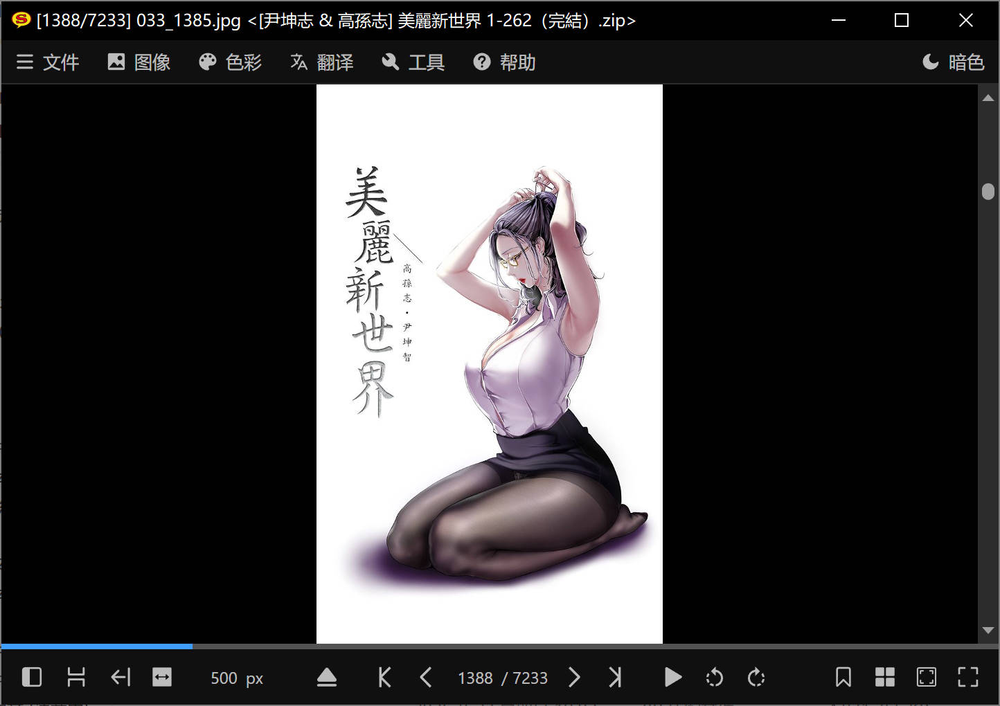

<h1>
  <p align="center">
    <br />SuperManGa
  </p>
</h1>


<p align="center">
  
  
  
</p>

<p align="center">
  <strong>A simple, focused local manga reader</strong>
</p>
<p align="center">
Single / Double Page / Webtoon Scroll · Image Resampling / Neural Upscaling / OCR Translation
</p>


<p align="center">
  
</p>


<h3 align="center">
  <a href="./README.md">中文</a> ｜ English ｜ <a href="./README_ja.md">日本語</a> ｜ <a href="./README_ko.md">한국어</a>
</h3>

## Background

I used to read manga on PC mainly with MangaMeeya, but a few issues kept bothering me: no Unicode path support, no animated images, and no webtoon-style scrolling.

I tried other readers too, but never found one I liked—most of them do not even offer basic image resampling.

So I decided to build one myself.

## Download

Pick an installer for your OS (`v1.0.2`). You can also browse all builds on [Releases](https://github.com/ssnangua/SuperManGa/releases):

| OS | Download | Min. OS |
| --- | --- | --- |
| Windows | [](https://github.com/ssnangua/SuperManGa/releases/download/v1.0.2/SuperManGa-1.0.2-windows-x64.zip) | Windows 10+ |
| macOS | [](https://github.com/ssnangua/SuperManGa/releases/download/v1.0.2/SuperManGa-1.0.2-macos-arm64.dmg) [](https://github.com/ssnangua/SuperManGa/releases/download/v1.0.2/SuperManGa-1.0.2-macos-x64.dmg) | macOS 10.15+ (Apple Silicon: 11+) |
| Linux | [](https://github.com/ssnangua/SuperManGa/releases/download/v1.0.2/SuperManGa-1.0.2-linux-arm64.deb) [](https://github.com/ssnangua/SuperManGa/releases/download/v1.0.2/SuperManGa-1.0.2-linux-x64.deb) | Ubuntu 22.04+ / Debian 12+ |

> [!NOTE]
> ONNX Runtime / upscale models / text detectors / OCR models are **not** bundled. Download them in-app when you need upscaling or translation.

<details>
<summary>macOS install and usage</summary>

1. Open the matching `.dmg` and drag `SuperManGa.app` into Applications (or any folder).
2. Current releases are not Apple-notarized. If the first launch is blocked (“cannot be verified”): go to **System Settings → Privacy & Security** and click **Open Anyway**; or **Control-click → Open** the `.app`; or run `xattr -dr com.apple.quarantine /Applications/SuperManGa.app` (adjust the path).

</details>

<details>
<summary>Linux install and usage</summary>

Run in the directory that contains the `.deb` (the leading `./` is required):

```bash
# x64
sudo apt install ./SuperManGa-*-linux-x64.deb

# arm64
sudo apt install ./SuperManGa-*-linux-arm64.deb
```

Or: `sudo dpkg -i SuperManGa-*-linux-*.deb`, then `sudo apt-get install -f` if dependencies are missing. After install, launch from the app menu or run `supermanga`.

</details>

## Features

|  | Feature | Notes |
| :---: | --- | --- |
|  | Local manga reading | Open folders, archives, or e-books |
|  | Single / double page | Page-based reading for traditional manga |
|  | **Webtoon scroll** | Continuous vertical scroll for webtoons |
|  | Reading direction | LTR / RTL (Japanese manga is often RTL) |
|  | Zoom modes | Fit window / original / fixed width / scale |
|  | Playback | Timed scroll / page turn |
|  | Thumbnail view | Grid of all pages |
|  | Minimal view | **Focus on reading** — content fills the window |
|  | Fullscreen | **Immersive reading** |
|  | Image resampling | Linear / bicubic / Lanczos / area average + sharpen |
|  | Anime4K | GPU shader enhance (sharpen / deblur) |
|  | **Neural upscale** | `MangaJaNai` / `Real-ESRGAN` |
|  | **Translation** | Text detect → OCR → online / AI translate |
|  | Color adjust | Brightness / contrast / saturation |
|  | Rotate | Rotate images |
|  | Magnifier | Local zoom for details |
|  | Bookmarks | Bookmarks with notes |
|  | Chapter detection | Split by filename rules; custom regex supported |
|  | Recent history | Remembers recent files and reading progress |
|  | UI languages | Simplified / Traditional Chinese, English, Japanese, Korean |
|  | Themes | Light / dark |

### Supported formats

| Type | Extensions / notes |
| --- | --- |
| Folder | Read images in order; optional recursive subfolders |
| Archive | `.zip` / `.cbz` / `.rar` / `.cbr` / `.7z` |
| E-book | `.epub` / `.pdf` / `.mobi` / `.azw3` / `.azw` |

> [!NOTE]
>
> - RAR / CBR / 7z are extracted to a local cache
> - PDF is exported or rasterized to a local cache; encrypted PDFs prompt for a password
> - KFX and DRM-protected Kindle books are not supported

### ONNX Runtime

Upscaling and translation need an ONNX Runtime pack:

| Platform | Runtime |
| --- | --- |
| Windows x64 | `CPU` / `CUDA 12` / `CUDA 13` |
| macOS arm64 | `CPU` (CoreML enabled automatically at inference) |
| macOS x64 | `CPU` (CoreML enabled automatically at inference) |
| Linux arm64 | `CPU` |
| Linux x64 | `CPU` / `CUDA 12` / `CUDA 13` |

> [!NOTE]
> The runtime does **not** include a full `CUDA` / `cuDNN` toolkit—install that on the machine yourself.

### Neural upscaling

| Type | Notes |
| --- | --- |
| Models | `MangaJaNai 2x` / `Real-ESRGAN Anime 2x` |

### Text detect → OCR → translate

A text detector finds regions on the page; OCR reads them; then a translation provider fills in the overlay.

| Type | Options |
| --- | --- |
| Detectors | `DBNet` / `CTD` / `YOLO` / `SaberYOLO` |
| OCR engines | `System OCR` (Windows only) / `Manga OCR` / `PaddleOCR` / `MIT 48px` / `EasyOCR` |

Translation providers:

| Provider | Notes |
| --- | --- |
| **AI translate** | OpenAI-compatible API; manga-oriented batch prompts |
| Microsoft Translator | Free Edge channel; no setup |
| Google Translate | Free web API; no setup |
| Yandex Translate | Free channel; no setup |
| DeepL | Official API; API Key required |
| Caiyun | Token required |
| Baidu Translate | Open platform; APP ID + secret |
| Youdao Translate | Open platform; app ID + secret |
| Tencent Translate | Tencent Cloud MT; SecretId / SecretKey |
| Volcengine Translate | Volcengine MT; Access Key |
| Alibaba Translate | Alibaba Cloud MT; AccessKey |

API keys are stored encrypted in the OS credential store (file-encrypted fallback if that fails)—**not** as plaintext in normal settings files.

Overlay style: font, size, horizontal/vertical, alignment, stroke, auto color, and more.

<details>
<summary>AI translate presets</summary>

| Provider | Default base URL |
| --- | --- |
| Local LM Studio | `http://127.0.0.1:1234/v1` |
| Local Ollama (OpenAI-compatible) | `http://127.0.0.1:11434/v1` |
| DeepSeek | `https://api.deepseek.com/v1` |
| Alibaba DashScope | `https://dashscope.aliyuncs.com/compatible-mode/v1` |
| Zhipu GLM | `https://open.bigmodel.cn/api/paas/v4` |
| Moonshot (Kimi) | `https://api.moonshot.cn/v1` |
| SiliconFlow | `https://api.siliconflow.cn/v1` |
| Agnes AI | `https://apihub.agnes-ai.com/v1` |
| MiniMax | `https://api.minimaxi.com/v1` |
| Xiaomi MiMo | `https://api.xiaomimimo.com/v1` |
| OpenAI | `https://api.openai.com/v1` |
| OpenRouter | `https://openrouter.ai/api/v1` |
| Google Gemini (OpenAI-compatible) | `https://generativelanguage.googleapis.com/v1beta/openai` |
| _Custom OpenAI-compatible_ | _(enter base URL manually)_ |

</details>

### App data

On Windows, the first launch creates `SuperManGaData/` next to the executable.

On macOS / Linux, the default is `SuperManGaData/` under the system app-data directory.

You can customize the **data directory** in **Settings → General**.

### Launch from the command line

```bash
# Windows
SuperManGa.exe C:\path\to\book.cbz

# Linux
supermanga /path/to/book.cbz

# macOS: run the binary
/Applications/SuperManGa.app/Contents/MacOS/SuperManGa /path/to/book.cbz

# macOS: via open (optional new instance)
open -n -a SuperManGa.app --args /path/to/book.cbz
```

On macOS, double-clicking an associated file in Finder, or `open -a SuperManGa.app /path/to/book.cbz` (without `--args`), also opens the path.

## FAQ

<details>
<summary>Portable Windows build says WebView2 is missing</summary>

> The reader needs **WebView2 Evergreen**. Win10/11 usually already have it; if not, install the runtime from the prompt and relaunch.

</details>

<details>
<summary>EPUB / MOBI opens with no pages</summary>

> This app only reads **images** inside e-books. Text-only books will show nothing.

</details>

## Other

- [Developer Documentation](./DOCS_en.md)

## Related

- RAR / CBR extraction uses the official [unrar](https://www.rarlab.com/) library. UnRAR’s license is separate from this project—see [RARLAB](https://www.rarlab.com/license.htm)
- PDF rendering uses [PDFium](https://pdfium.googlesource.com/pdfium/)
- Neural upscaling uses [ONNX Runtime](https://onnxruntime.ai/)
- Text detect / OCR / translate pipelines draw on ideas from manga translation tools such as [Saber-Translator](https://github.com/MashiroSaber03/Saber-Translator) and [manga-image-translator](https://github.com/zyddnys/manga-image-translator)
