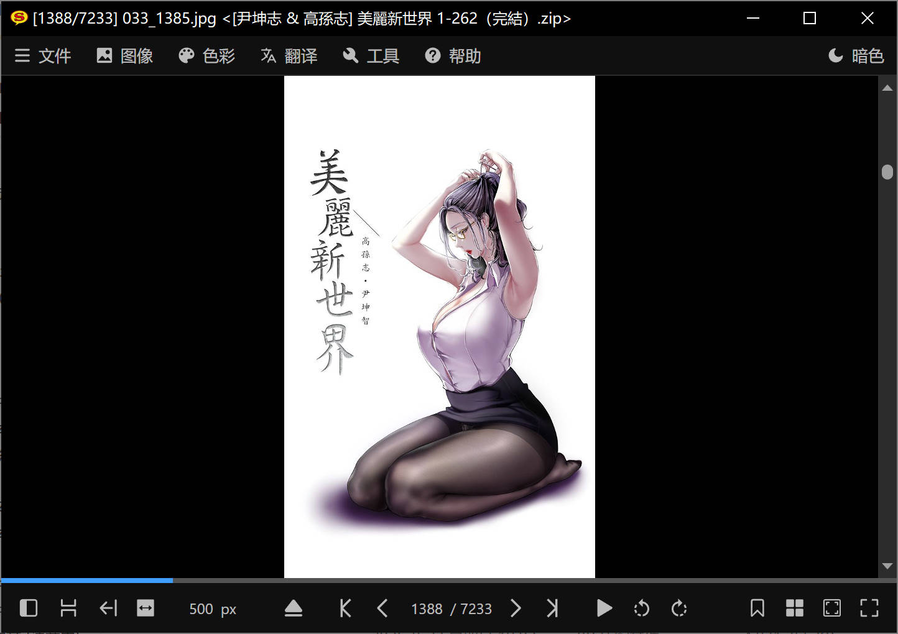

<h1>
  <p align="center">
    <br />SuperManGa
  </p>
</h1>


<p align="center">
  
  
  
</p>

<p align="center">
  <strong>シンプルで純粋なローカル漫画リーダー</strong>
</p>

<p align="center">
単ページ / 見開き / 縦スクロール · 画像リサンプリング / ニューラル超解像 / OCR 翻訳
</p>

<p align="center">
  
</p>


<h3 align="center">
  <a href="./README.md">中文</a> ｜ <a href="./README_en.md">English</a> ｜ 日本語 ｜ <a href="./README_ko.md">한국어</a>
</h3>

## 背景

以前は主に MangaMeeya で PC 漫画を読んでいましたが、Unicode パス非対応・アニメ画像非対応・縦スクロール（Webtoon）非対応が悩みでした。

他のリーダーも試しましたが、満足できるものは見つからず、基本的な画像リサンプリングすらないものがほとんどでした。

そこで自分で作ることにしました。

## ダウンロード

OS に合わせて `v0.1.8` を選んでください（全バージョンは [Releases](https://github.com/ssnangua/SuperManGa/releases)）：

| OS | ダウンロード | 最低 OS |
| --- | --- | --- |
| Windows | [](https://github.com/ssnangua/SuperManGa/releases/download/v0.1.8/SuperManGa-0.1.8-windows-x64.zip) | Windows 10+ |
| macOS | [](https://github.com/ssnangua/SuperManGa/releases/download/v0.1.8/SuperManGa-0.1.8-macos-arm64.dmg) [](https://github.com/ssnangua/SuperManGa/releases/download/v0.1.8/SuperManGa-0.1.8-macos-x64.dmg) | macOS 10.15+（Apple Silicon は 11+） |
| Linux | [](https://github.com/ssnangua/SuperManGa/releases/download/v0.1.8/SuperManGa-0.1.8-linux-arm64.deb) [](https://github.com/ssnangua/SuperManGa/releases/download/v0.1.8/SuperManGa-0.1.8-linux-x64.deb) | Ubuntu 22.04+ / Debian 12+ |

> [!NOTE]
> ONNX ランタイム / 超解像モデル / 文字検出モデル / OCR モデルは **インストーラに含まれません**。超解像 / 翻訳を使う場合はアプリ内でダウンロードしてください。

<details>
<summary>macOS のインストールと使い方</summary>

1. 対応アーキテクチャの `.dmg` を開き、`SuperManGa.app` を「アプリケーション」へドラッグします（任意のフォルダでも可）。
2. 現状の配布物は Apple の公証署名がありません。初回起動で開発元を確認できないと出る場合：**システム設定 → プライバシーとセキュリティ** で **このまま開く**；または `.app` を **右クリック → 開く**；または `xattr -dr com.apple.quarantine /Applications/SuperManGa.app`（パスは実際の場所に合わせて変更）。

</details>

<details>
<summary>Linux のインストールと使い方</summary>

`.deb` があるディレクトリで実行（先頭の `./` は省略不可）：

```bash
# x64
sudo apt install ./SuperManGa-*-linux-x64.deb

# arm64
sudo apt install ./SuperManGa-*-linux-arm64.deb
```

または `sudo dpkg -i SuperManGa-*-linux-*.deb`。依存関係が足りないときは `sudo apt-get install -f`。インストール後はアプリメニュー、または `supermanga` で起動できます。

</details>

## 機能

|  | 機能 | 説明 |
| :---: | --- | --- |
|  | ローカル漫画 | フォルダ・圧縮ファイル・電子書籍を開く |
|  | 単ページ / 見開き | ページ送り。従来の漫画向け |
|  | **縦スクロール** | 連続縦スクロール。Webtoon 向け |
|  | 開き方向 | 左開き / 右開き（日本の漫画は右開きが多い） |
|  | ズーム | ウィンドウに合わせる / 原寸 / 固定幅 / 倍率 |
|  | 再生 | 定時スクロール / ページ送り |
|  | サムネイル | 全ページをグリッド表示 |
|  | ミニマル表示 | **読書に集中**。表示領域を最大化 |
|  | フルスクリーン | **没入読書** |
|  | 画像リサンプリング | 線形 / バイキュービック / Lanczos / 平均画素 + シャープ |
|  | Anime4K | GPU シェーダによるシャープ / デブラー |
|  | **ニューラル超解像** | `MangaJaNai` / `Real-ESRGAN` |
|  | **翻訳** | 文字検出 → OCR → オンライン / AI 翻訳 |
|  | 色調整 | 明るさ / コントラスト / 彩度 |
|  | 回転 | 画像を回転 |
|  | ルーペ | 局所拡大 |
|  | ブックマーク | メモ付きブックマーク |
|  | 章検出 | ファイル名ルールで章分け。独自正規表現可 |
|  | 最近の履歴 | 最近開いたファイルと読書位置を記憶 |
|  | 多言語 UI | 簡体字 / 繁体字 / 英 / 日 / 韓 |
|  | テーマ | ライト / ダーク |

### 対応形式

| 種類 | 拡張子 / 説明 |
| --- | --- |
| フォルダ | 画像順に表示。サブフォルダ再帰可 |
| 圧縮 | `.zip` / `.cbz` / `.rar` / `.cbr` / `.7z` |
| 電子書籍 | `.epub` / `.pdf` / `.mobi` / `.azw3` / `.azw` |

> [!NOTE]
>
> - RAR / CBR / 7z はローカルキャッシュへ展開
> - PDF はエクスポートまたはラスタライズしてローカルキャッシュへ。暗号化 PDF はパスワード入力
> - KFX および DRM 付き Kindle は非対応

### ONNX ランタイム

超解像と翻訳は ONNX ランタイムが必要です：

| プラットフォーム | ランタイム |
| --- | --- |
| Windows x64 | `CPU` / `CUDA 12` / `CUDA 13` |
| macOS arm64 | `CPU`（推論時に CoreML を自動有効化） |
| macOS x64 | `CPU`（推論時に CoreML を自動有効化） |
| Linux arm64 | `CPU` |
| Linux x64 | `CPU` / `CUDA 12` / `CUDA 13` |

> [!NOTE]
> ランタイムに完全な `CUDA` / `cuDNN` は **含まれません**。PC 側でツールキットを用意してください。

### ニューラル超解像

| 種類 | 説明 |
| --- | --- |
| モデル | `MangaJaNai 2x` / `Real-ESRGAN Anime 2x` |

### 文字検出 → OCR → 翻訳

文字検出で領域を取り、OCR で読み取り、翻訳サービスでオーバーレイします。

| 種類 | 選択肢 |
| --- | --- |
| 検出器 | `DBNet` / `CTD` / `YOLO` / `SaberYOLO` |
| OCR | `システム OCR`（Windows のみ） / `Manga OCR` / `PaddleOCR` / `MIT 48px` / `EasyOCR` |

翻訳サービス：

| サービス | 説明 |
| --- | --- |
| **AI 翻訳** | OpenAI 互換 API。漫画向け一括プロンプト |
| Microsoft 翻訳 | Edge 無料チャネル。設定不要 |
| Google 翻訳 | 無料 Web API。設定不要 |
| Yandex 翻訳 | 無料チャネル。設定不要 |
| DeepL | 公式 API。API Key 必須 |
| 彩雲小訳 | Token 必須 |
| 百度翻訳 | 開放プラットフォーム。APP ID + シークレット |
| 有道翻訳 | 開放プラットフォーム。アプリ ID + シークレット |
| 騰訊翻訳 | 騰訊クラウド MT。SecretId / SecretKey |
| 火山翻訳 | Volcengine MT。Access Key |
| 阿里翻訳 | Alibaba Cloud MT。AccessKey |

API キーは OS 資格情報ストアに暗号化保存（失敗時はファイル暗号化へフォールバック）。通常の設定ファイルには **平文で書きません**。

フォント・サイズ・縦横・揃え・縁取り・自動配色などオーバーレイスタイルを調整できます。

<details>
<summary>AI 翻訳のプリセット</summary>

| サービス | デフォルト Base URL |
| --- | --- |
| ローカル LM Studio | `http://127.0.0.1:1234/v1` |
| ローカル Ollama（OpenAI 互換） | `http://127.0.0.1:11434/v1` |
| DeepSeek | `https://api.deepseek.com/v1` |
| 阿里雲 DashScope | `https://dashscope.aliyuncs.com/compatible-mode/v1` |
| 智譜 GLM | `https://open.bigmodel.cn/api/paas/v4` |
| Moonshot（Kimi） | `https://api.moonshot.cn/v1` |
| SiliconFlow | `https://api.siliconflow.cn/v1` |
| Agnes AI | `https://apihub.agnes-ai.com/v1` |
| MiniMax | `https://api.minimaxi.com/v1` |
| 小米 MiMo | `https://api.xiaomimimo.com/v1` |
| OpenAI | `https://api.openai.com/v1` |
| OpenRouter | `https://openrouter.ai/api/v1` |
| Google Gemini（OpenAI 互換） | `https://generativelanguage.googleapis.com/v1beta/openai` |
| _カスタム OpenAI 互換_ | _（Base URL を手動入力）_ |

</details>

### アプリデータ

Windows では初回起動時、実行ファイルと同じ場所に `SuperManGaData/` を作成します。

macOS / Linux ではシステム AppData 配下の `SuperManGaData/` を既定にします。

**設定 → 一般** で **データディレクトリ** を変更できます。

## よくある質問

<details>
<summary>Windows ポータブル版で WebView2 がないと出る</summary>

> **WebView2 Evergreen** が必要です。Win10/11 には通常入っています。無い場合は案内に従ってランタイムを入れてから再起動してください。

</details>

<details>
<summary>EPUB / MOBI を開いてもページが無い</summary>

> 本アプリは電子書籍内の **画像** だけを読みます。テキストのみの本は表示されません。

</details>

## その他

- [開発ドキュメント（英語）](./DOCS_en.md)

## 関連

- RAR / CBR 展開には公式 [unrar](https://www.rarlab.com/) を使用。UnRAR ライセンスは本プロジェクトとは別です → [RARLAB](https://www.rarlab.com/license.htm)
- PDF 描画は [PDFium](https://pdfium.googlesource.com/pdfium/)
- ニューラル超解像は [ONNX Runtime](https://onnxruntime.ai/)
- 文字検出 / OCR / 翻訳は [Saber-Translator](https://github.com/MashiroSaber03/Saber-Translator) や [manga-image-translator](https://github.com/zyddnys/manga-image-translator) などの漫画翻訳ツールを参考にしています
