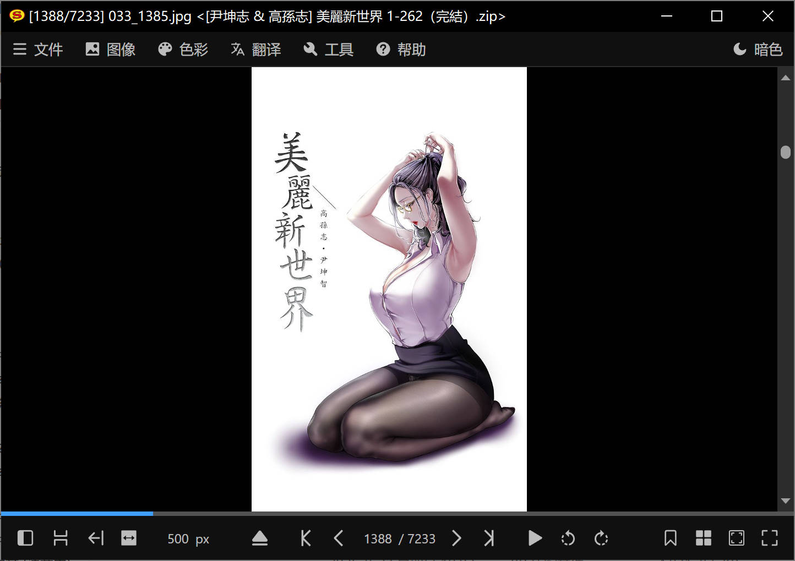

<h1>
  <p align="center">
    <br />SuperManGa
  </p>
</h1>


<p align="center">
  
  
  
</p>

<p align="center">
  <strong>단순하고 집중된 로컬 만화 리더</strong>
</p>

<p align="center">
단페이지 / 양페이지 / 스크롤 · 이미지 리샘플링 / 신경망 업스케일 / OCR 번역
</p>

<p align="center">
  
</p>


<h3 align="center">
  <a href="./README.md">中文</a> ｜ <a href="./README_en.md">English</a> ｜ <a href="./README_ja.md">日本語</a> ｜ 한국어
</h3>

## 배경

예전에는 PC에서 주로 MangaMeeya로 만화를 봤지만, Unicode 경로 미지원·움직이는 이미지 미지원·웹툰형 세로 스크롤 미지원이 불편했습니다.

다른 리더도 써 봤지만 마음에 드는 것을 찾지 못했고, 기본적인 이미지 리샘플링조차 없는 경우가 많았습니다.

그래서 직접 만들기로 했습니다.

## 다운로드

OS에 맞는 `v1.0.3` 패키지를 선택하세요. 전체 버전은 [Releases](https://github.com/ssnangua/SuperManGa/releases)에서 확인할 수 있습니다:

| OS | 다운로드 | 최소 OS |
| --- | --- | --- |
| Windows | [](https://github.com/ssnangua/SuperManGa/releases/download/v1.0.3/SuperManGa-1.0.3-windows-x64.zip) | Windows 10+ |
| macOS | [](https://github.com/ssnangua/SuperManGa/releases/download/v1.0.3/SuperManGa-1.0.3-macos-arm64.dmg) [](https://github.com/ssnangua/SuperManGa/releases/download/v1.0.3/SuperManGa-1.0.3-macos-x64.dmg) | macOS 10.15+（Apple Silicon은 11+） |
| Linux | [](https://github.com/ssnangua/SuperManGa/releases/download/v1.0.3/SuperManGa-1.0.3-linux-arm64.deb) [](https://github.com/ssnangua/SuperManGa/releases/download/v1.0.3/SuperManGa-1.0.3-linux-x64.deb) | Ubuntu 22.04+ / Debian 12+ |

> [!NOTE]
> ONNX 런타임 / 업스케일 모델 / 문자 검출 모델 / OCR 모델은 **설치 패키지에 포함되지 않습니다**. 업스케일 / 번역을 쓰려면 앱에서 직접 다운로드하세요.

<details>
<summary>macOS 설치 및 사용</summary>

1. 해당 아키텍처 `.dmg`를 열고 `SuperManGa.app`을 응용 프로그램(또는 원하는 폴더)으로 드래그합니다.
2. 현재 배포본은 Apple 공증 서명이 없습니다. 처음 실행 시 확인되지 않은 개발자라고 나오면: **시스템 설정 → 개인정보 보호 및 보안**에서 **그래도 열기**; 또는 `.app`을 **우클릭 → 열기**; 또는 `xattr -dr com.apple.quarantine /Applications/SuperManGa.app` (경로는 실제 위치에 맞게 변경).

</details>

<details>
<summary>Linux 설치 및 사용</summary>

`.deb`가 있는 디렉터리에서 실행하세요(`./`는 생략하면 안 됩니다):

```bash
# x64
sudo apt install ./SuperManGa-*-linux-x64.deb

# arm64
sudo apt install ./SuperManGa-*-linux-arm64.deb
```

또는 `sudo dpkg -i SuperManGa-*-linux-*.deb`. 의존성이 모자라면 `sudo apt-get install -f`. 설치 후 앱 메뉴에서 실행하거나 `supermanga`를 실행하면 됩니다.

</details>

## 기능

|  | 기능 | 설명 |
| :---: | --- | --- |
|  | 로컬 만화 | 폴더·압축·전자책 열기 |
|  | 단페이지 / 양페이지 | 페이지 넘김. 전통 만화에 적합 |
|  | **세로 스크롤** | 연속 세로 스크롤. 웹툰에 적합 |
|  | 넘김 방향 | 좌→우 / 우→좌 (일본 만화는 보통 우→좌) |
|  | 확대 모드 | 창 맞춤 / 원본 / 고정 폭 / 배율 |
|  | 재생 | 타이머 스크롤 / 자동 넘김 |
|  | 썸네일 | 전체 페이지 격자 보기 |
|  | 미니멀 보기 | **독서에 집중**. 읽기 영역 최대화 |
|  | 전체 화면 | **몰입 독서** |
|  | 이미지 리샘플링 | 선형 / 바이큐빅 / Lanczos / 영역 평균 + 샤픈 |
|  | Anime4K | GPU 셰이더 선명화 / 디블러 |
|  | **신경망 업스케일** | `MangaJaNai` / `Real-ESRGAN` |
|  | **번역** | 문자 검출 → OCR → 온라인 / AI 번역 |
|  | 색 보정 | 밝기 / 대비 / 채도 |
|  | 회전 | 이미지 회전 |
|  | 돋보기 | 부분 확대 |
|  | 북마크 | 메모 있는 북마크 |
|  | 챕터 인식 | 파일명 규칙으로 챕터 분리. 사용자 정규식 지원 |
|  | 최근 기록 | 최근 파일과 읽기 위치 기억 |
|  | UI 언어 | 간체 / 번체 / 영 / 일 / 한 |
|  | 테마 | 밝음 / 어두움 |

### 지원 형식

| 종류 | 확장자 / 설명 |
| --- | --- |
| 폴더 | 이미지 순서대로 읽기. 하위 폴더 재귀 가능 |
| 압축 | `.zip` / `.cbz` / `.rar` / `.cbr` / `.7z` |
| 전자책 | `.epub` / `.pdf` / `.mobi` / `.azw3` / `.azw` |

> [!NOTE]
>
> - RAR / CBR / 7z는 로컬 캐시에 압축 해제
> - PDF는 내보내기 또는 래스터화하여 로컬 캐시에 저장. 암호화 PDF는 비밀번호 입력
> - KFX 및 DRM Kindle 전자책은 미지원

### ONNX 런타임

업스케일과 번역에는 ONNX 런타임이 필요합니다:

| 플랫폼 | 런타임 |
| --- | --- |
| Windows x64 | `CPU` / `CUDA 12` / `CUDA 13` |
| macOS arm64 | `CPU` (추론 시 CoreML 자동 사용) |
| macOS x64 | `CPU` (추론 시 CoreML 자동 사용) |
| Linux arm64 | `CPU` |
| Linux x64 | `CPU` / `CUDA 12` / `CUDA 13` |

> [!NOTE]
> 런타임에 완전한 `CUDA` / `cuDNN`는 **포함되지 않습니다**. PC에 툴킷을 직접 설치하세요.

### 신경망 업스케일

| 종류 | 설명 |
| --- | --- |
| 모델 | `MangaJaNai 2x` / `Real-ESRGAN Anime 2x` |

### 문자 검출 → OCR → 번역

문자 검출기로 영역을 찾고, OCR로 인식한 뒤 번역 서비스로 오버레이합니다.

| 종류 | 옵션 |
| --- | --- |
| 검출기 | `DBNet` / `CTD` / `YOLO` / `SaberYOLO` |
| OCR | `시스템 OCR`(Windows만) / `Manga OCR` / `PaddleOCR` / `MIT 48px` / `EasyOCR` |

번역 서비스:

| 서비스 | 설명 |
| --- | --- |
| **AI 번역** | OpenAI 호환 API. 만화용 일괄 프롬프트 |
| Microsoft 번역 | Edge 무료 채널. 설정 불필요 |
| Google 번역 | 무료 웹 API. 설정 불필요 |
| Yandex 번역 | 무료 채널. 설정 불필요 |
| DeepL | 공식 API. API Key 필요 |
| 차이윈(彩云小译) | Token 필요 |
| 바이두 번역 | 오픈 플랫폼. APP ID + 시크릿 |
| 유다오 번역 | 오픈 플랫폼. 앱 ID + 시크릿 |
| 텐센트 번역 | 텐센트 클라우드 MT. SecretId / SecretKey |
| 화산 번역 | Volcengine MT. Access Key |
| 알리바바 번역 | Alibaba Cloud MT. AccessKey |

API 키는 OS 자격 증명 저장소에 암호화되어 보관됩니다(실패 시 파일 암호화로 대체). 일반 설정 파일에는 **평문으로 쓰지 않습니다**.

글꼴·크기·가로/세로·정렬·외곽선·자동 색상 등 오버레이 스타일을 조정할 수 있습니다.

<details>
<summary>AI 번역 프리셋</summary>

| 서비스 | 기본 Base URL |
| --- | --- |
| 로컬 LM Studio | `http://127.0.0.1:1234/v1` |
| 로컬 Ollama (OpenAI 호환) | `http://127.0.0.1:11434/v1` |
| DeepSeek | `https://api.deepseek.com/v1` |
| 알리바바 DashScope | `https://dashscope.aliyuncs.com/compatible-mode/v1` |
| 지푸 GLM | `https://open.bigmodel.cn/api/paas/v4` |
| Moonshot (Kimi) | `https://api.moonshot.cn/v1` |
| SiliconFlow | `https://api.siliconflow.cn/v1` |
| Agnes AI | `https://apihub.agnes-ai.com/v1` |
| MiniMax | `https://api.minimaxi.com/v1` |
| 샤오미 MiMo | `https://api.xiaomimimo.com/v1` |
| OpenAI | `https://api.openai.com/v1` |
| OpenRouter | `https://openrouter.ai/api/v1` |
| Google Gemini (OpenAI 호환) | `https://generativelanguage.googleapis.com/v1beta/openai` |
| _사용자 지정 OpenAI 호환_ | _(Base URL 직접 입력)_ |

</details>

### 앱 데이터

Windows에서는 첫 실행 시 실행 파일과 같은 위치에 `SuperManGaData/`를 만듭니다.

macOS / Linux는 시스템 앱 데이터 폴더 아래 `SuperManGaData/`를 기본으로 둡니다.

**설정 → 일반**에서 **데이터 디렉터리**를 변경할 수 있습니다.

### 명령줄에서 열기

```bash
# Windows
SuperManGa.exe C:\path\to\book.cbz

# Linux
supermanga /path/to/book.cbz

# macOS: 실행 파일 직접 호출
/Applications/SuperManGa.app/Contents/MacOS/SuperManGa /path/to/book.cbz

# macOS: open 으로 인자 전달 (새 인스턴스 가능)
open -n -a SuperManGa.app --args /path/to/book.cbz
```

macOS에서는 Finder에서 연결 파일을 더블클릭하거나, `open -a SuperManGa.app /path/to/book.cbz`(`--args` 없음)로도 열 수 있습니다.

## 자주 묻는 질문

<details>
<summary>Windows 포터블 버전에서 WebView2가 없다고 함</summary>

> **WebView2 Evergreen**가 필요합니다. Win10/11에는 보통 포함되어 있습니다. 없으면 안내에 따라 런타임을 설치한 뒤 다시 실행하세요.

</details>

<details>
<summary>EPUB / MOBI를 열었는데 페이지가 없음</summary>

> 이 앱은 전자책 안의 **이미지**만 읽습니다. 텍스트만 있는 책은 내용이 없습니다.

</details>

## 기타

- [개발 문서 (영어)](./DOCS_en.md)

## 관련

- RAR / CBR 해제는 공식 [unrar](https://www.rarlab.com/) 를 사용합니다. UnRAR 라이선스는 본 프로젝트와 별개입니다 → [RARLAB](https://www.rarlab.com/license.htm)
- PDF 렌더링은 [PDFium](https://pdfium.googlesource.com/pdfium/)
- 신경망 업스케일은 [ONNX Runtime](https://onnxruntime.ai/)
- 문자 검출 / OCR / 번역은 [Saber-Translator](https://github.com/MashiroSaber03/Saber-Translator), [manga-image-translator](https://github.com/zyddnys/manga-image-translator) 등 만화 번역 도구를 참고했습니다
