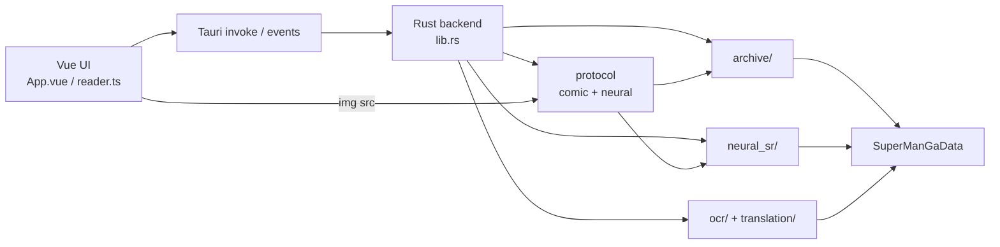
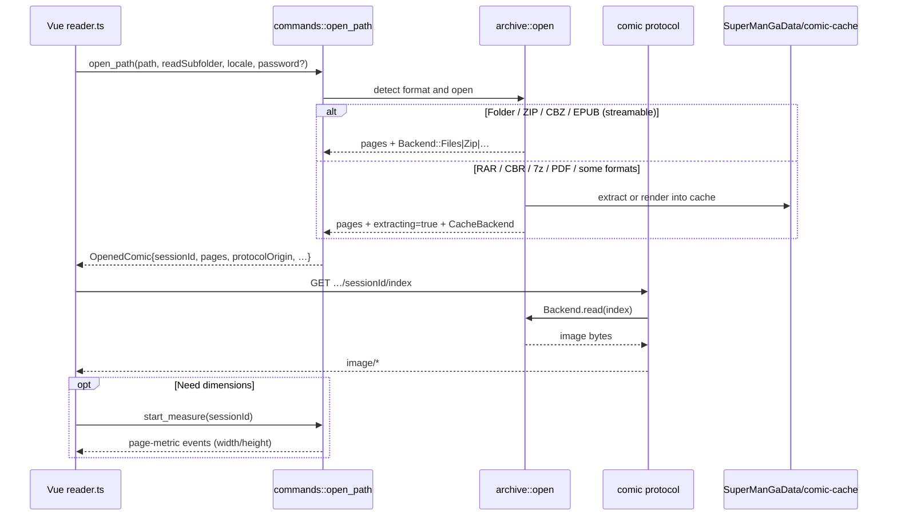
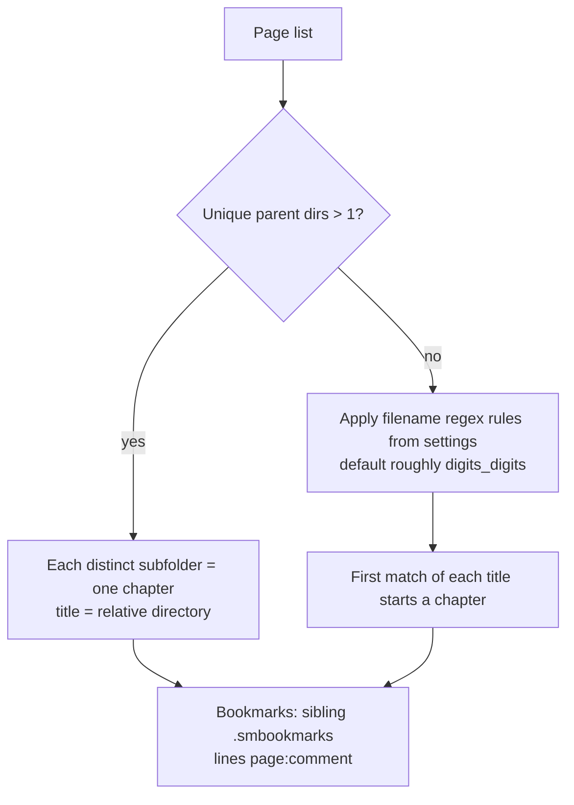
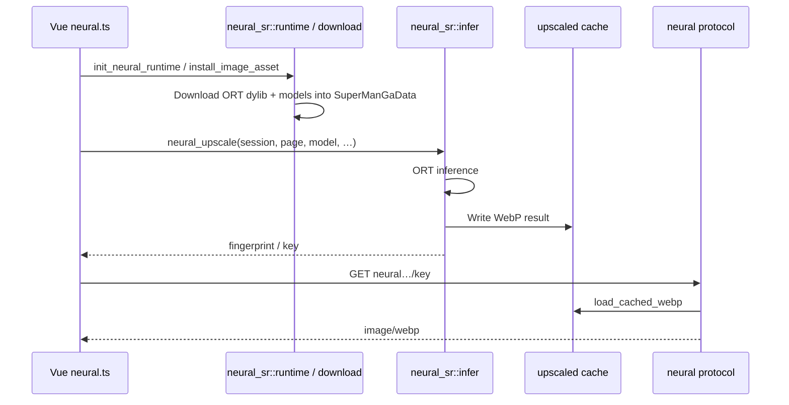
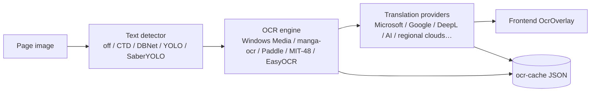
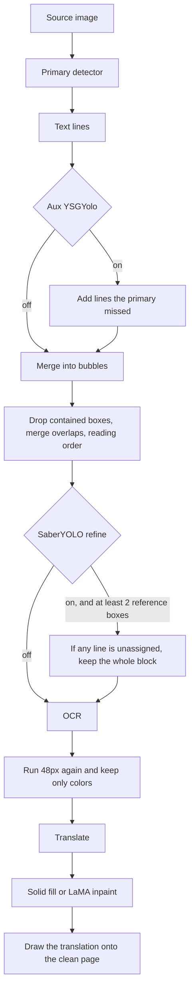

# Developer Documentation

This document is for developers and maintainers. User-facing notes live in [README_en.md](README_en.md).

---

## Contents

1. [Overview](#1-overview)
2. [Development / Build / Release](#2-development--build--release)
3. [Directory structure](#3-directory-structure)
4. [Architecture & modules](#4-architecture--modules)
5. [Cross-platform differences](#5-cross-platform-differences)
6. [Internationalization (i18n)](#6-internationalization-i18n)
7. [Appendix: formats & licenses](#7-appendix-formats--licenses)
8. [Appendix: detector export](#8-appendix-detector-export)
9. [Appendix: differences from Saber-Translator](#9-appendix-differences-from-saber-translator)

---

## 1. Overview

SuperManGa is a **Vue 3 + Tauri 2** desktop app: open one folder, archive, or ebook at a time; read as a continuous vertical webtoon scroll, or as single- / double-page flips. Optional neural upscaling and translation (text detection → OCR → online translation).

| Layer | Stack |
|---|---|
| Frontend | Vue 3, Vite, TypeScript, vue-i18n |
| Desktop shell | Tauri 2, Rust |
| Native deps | pdfium (fetched per platform), ONNX Runtime (downloaded on demand), UnRAR (RAR/CBR) |

Page images are served through a custom protocol (Windows / Android: `http://comic.localhost`; elsewhere: `comic://localhost`). Upscale results use the `neural` protocol the same way.

File associations, context menu, WebView2 checks, and Windows Media OCR are Windows-specific. Primary-instance locking exists on all desktop platforms.

---

## 2. Development / Build / Release

### 2.1 Prerequisites

| Dependency | Notes |
|---|---|
| **Node.js** | Version in [`.node-version`](../.node-version) (currently `22.22.2`) |
| **Rust** | Stable toolchain compatible with Tauri 2 |
| **Windows** | Visual Studio **C++ build tools**; **WebView2** Evergreen (usually present on Win10/11; portable builds check at startup and show a native prompt + Microsoft download link if missing) |
| **Linux** | `webkit2gtk-4.1` and build deps (see CI: `libwebkit2gtk-4.1-dev`, `libayatana-appindicator3-dev`, `librsvg2-dev`, `patchelf`, etc.) |
| **macOS** | Xcode CLT; system WKWebView |

### 2.2 Local development

```bash
npm install
npm run fetch:pdfium   # Fetch host-platform pdfium (Win: pdfium.dll / macOS: libpdfium.dylib / Linux: libpdfium.so)
npm run dev
```

- `npm run dev` runs `predev` first (`fetch-pdfium.mjs --optional`); a failed fetch does not block.
- Encrypted PDFs / PDF rasterization need pdfium; release `beforeBuildCommand` and CI fetch per target and bundle it.
- Dev server defaults to `http://localhost:1420` (`devUrl` in `tauri.conf.json`).

**Browser demo (no local files):**

```
http://localhost:1420/?demo=1
```

Uses a synthetic 24-page book to exercise the UI.

### 2.3 Local build and Windows portable package

```bash
npm run build         # all platforms: tauri build --no-bundle (no installers)
npm run build:win     # Windows: compile + portable zip
npm run build:mac     # macOS: dmg (cross-compile with -- --target …)
npm run build:linux   # Linux: deb
```

| Script | Role |
|---|---|
| `build` | Frontend + Rust with `--no-bundle`; **safe on any host** |
| `build:win` | Windows only: `build`, then pack `supermanga.exe` (+ pdfium) into `SuperManGa-*-windows-x64.zip` |
| `build:mac` | macOS only: `tauri build --bundles dmg` |
| `build:linux` | Linux only: `tauri build --bundles deb` |

Windows artifact:

```
src-tauri/target/release/bundle/portable/SuperManGa-*-windows-x64.zip
└── SuperManGa-*-windows-x64
    ├── SuperManGa.exe
    └── pdfium.dll
```

**Windows:** On first run the app creates `SuperManGaData/` next to the exe (falls back to the OS app-data directory if not writable).

**macOS / Linux:** Default is `SuperManGaData/` under the OS app-data directory (not inside the `.app`, so upgrades do not wipe data).

### 2.4 GitHub Actions release

Workflow: [`.github/workflows/release.yml`](../.github/workflows/release.yml)

1. Bump with npm (updates `package.json`, then the `version` hook syncs `Cargo.toml`, `tauri.conf.json`, and README download links, then commits and tags `v*`):

   ```bash
   npm version patch   # or minor / major
   git push origin HEAD --follow-tags
   ```

   If you only edited `package.json` and have not tagged yet: `npm run sync-version`.

2. On a `v*` tag push, CI verifies the tag matches all three versions, then builds and uploads:

| Platform | Artifacts | Min. OS |
|---|---|---|
| Windows x64 | `SuperManGa-*-windows-x64.zip` (portable) | Windows 10+ |
| macOS arm64 | `SuperManGa-*-macos-arm64.dmg` | macOS 11+ |
| macOS x64 | `SuperManGa-*-macos-x64.dmg` | macOS 10.15+ |
| Linux arm64 | `SuperManGa-*-linux-arm64.deb` | Ubuntu 22.04+ / Debian 12+ |
| Linux x64 | `SuperManGa-*-linux-x64.deb` | Ubuntu 22.04+ / Debian 12+ |

You can also run **Release** via `workflow_dispatch` to collect build artifacts without publishing a GitHub Release.

### 2.5 macOS install and usage

Current releases are not Developer ID–signed or notarized, so Gatekeeper may block launch (“cannot be verified” / unidentified developer).

`tauri.conf.json` sets `bundle.macOS.signingIdentity` to `"-"` (ad-hoc) and `hardenedRuntime` to `false`, and CI does not notarize. Downloaded `.dmg` / `.app` files get `com.apple.quarantine`.

**User workaround:**

1. Go to **System Settings → Privacy & Security**, scroll down, and click **Open Anyway** (confirm once more).
2. Or **Control-click → Open** the `.app` (more likely to prompt than a normal double-click).
3. Or clear quarantine, then open: `xattr -dr com.apple.quarantine /Applications/SuperManGa.app` (adjust the path).

**Proper fix (maintainers):**

Join the [Apple Developer Program](https://developer.apple.com/programs/), sign with a **Developer ID Application** certificate, enable `hardenedRuntime`, and **notarize + staple** the `.app` / `.dmg`. Wire certificate + `APPLE_ID` / Team ID / app-specific password (or API key) into CI secrets.

Until then, docs/FAQ should mention the workaround above.

### 2.6 Linux install and usage

`.deb` packages are built on Ubuntu 22.04 (glibc **2.35**) so they run on Debian 12 / Ubuntu 22.04+.

Run in the directory that contains the `.deb` (the leading `./` is required):

```bash
# x64
sudo apt install ./SuperManGa-*-linux-x64.deb

# arm64
sudo apt install ./SuperManGa-*-linux-arm64.deb
```

Or: `sudo dpkg -i SuperManGa-*-linux-*.deb`, then `sudo apt-get install -f` if dependencies are missing. After install, launch from the app menu or run `supermanga`.

### 2.7 ONNX runtime & models

Use [`tools/pack-data/`](../tools/pack-data/) to pack runtimes and models. Output is a set of `{stem}-v{ver}.zip` files plus a `manifest.json`, all published on GitHub Release tag **`data`**.

On disk:

```
<data root>/SuperManGaData/data/
├── {stem}-v{ver}/
└── manifest.json
```

Manifest entries are `{ version, bytes, sha256 }`:
- `version`: asset version
- `bytes`: download size shown in the UI
- `sha256`: reject corrupt zips after download

The app ships a seed manifest. Settings → General → Fetch Latest Asset Catalog on Startup (`fetchDataManifestOnStartup`, default on):
- On: after launch, silent background fetch with a short timeout
- Off: pull manually

Runtime selection (per-platform download; stem like `runtime-{os}-{arch}-{flavor}`, e.g. `runtime-macos-arm64-cpu`):

| Machine | Behavior |
|---|---|
| Matching local `runtime-*-cuda*-v…` | Use CUDA ORT; GPU EP when usable |
| No CUDA / no GPU pack, but local `runtime-*-cpu-v…` present | Auto-select CPU; shows Ready |
| CUDA pack only, no local CPU pack | Shows Initialize; must download CPU |

- ORT CUDA packs are Windows/Linux x64 only
- macOS uses the same CPU pack and enables the **CoreML** EP at inference time (Apple GPU / Neural Engine)
- macOS Intel (x64) uses the last official prebuild **ORT 1.23.0** (`runtime-macos-x64-cpu`); other platforms use 1.30
- ONNX model packs are cross-platform

### 2.8 Windows full offline package

For **unpack-and-run upscaling / translation**, build a full offline package (app + ONNX runtime + all models):

```bash
# Need a portable zip (or at least target/release/supermanga.exe)
npm run build:win          # skip if portable already exists
# Optional: build data zips locally
cd tools/pack-data && python pack.py && cd ../..

npm run bundle:win-full
# Output:
#   src-tauri/target/release/bundle/portable/SuperManGa-*-full-windows-x64.zip
```

Layout:

```
SuperManGa-*-full-windows-x64/
├── SuperManGa.exe
├── pdfium.dll
└── SuperManGaData/data/   # manifest + versioned runtime/detector/ocr/neural folders
```

Reuse rules:

- Existing `…/portable/SuperManGa-*-windows-x64.zip` → **no app rebuild**; if only `supermanga.exe` exists, runs `pack-portable.mjs` only
- Existing `tools/pack-data/data/{pack}.zip` (and `manifest.json` there) → **no GitHub download** for that pack; missing packs fall back to Release tag `data`

Offline packs must include the local **CPU** flavor.

---

## 3. Directory structure

```
SuperManGa/
├── package.json              # name: supermanga
├── .node-version
├── index.html / log.html     # Vite multi-page entries (repo-root is Vite/Tauri convention)
├── README.md                 # Chinese user guide (repo homepage)
├── docs/
│   ├── README_en.md / README_ja.md / README_ko.md
│   ├── DOCS_zh.md / DOCS_en.md
│   └── screenshot.jpg
├── public/
│   └── icon.png
├── scripts/
│   ├── fetch-pdfium.mjs
│   ├── pack-portable.mjs
│   ├── bundle-win-full.mjs
│   └── check-i18n.mjs
├── tools/                    # Offline tooling (not shipped in the app)
│   ├── pack-data/            # Build data Release zips + manifest
│   └── export-detectors/     # Text detectors → ONNX (for pack-data)
├── src/                      # Vue frontend
│   ├── main.ts               # Main window entry
│   ├── log-main.ts / LogApp.vue
│   ├── App.vue
│   ├── reader.ts             # Reading state, open comic, settings, shortcuts
│   ├── i18n.ts               # Five UI locales
│   ├── components/           # Reader UI, settings, OCR/neural asset dialogs, …
│   ├── composables/
│   ├── assets/
│   └── lib/
│       ├── ocr/              # Detector/engine catalogs, availability, translate queue
│       ├── render/           # Neural upscale, resample worker, texture limits
│       ├── translation/      # Provider types, defaults, fonts
│       ├── chapters.ts / chapterRules.ts / bookmarks.ts
│       └── updateCheck.ts
└── src-tauri/
    ├── tauri.conf.json       # productName: SuperManGa
    ├── Cargo.toml            # package name: supermanga
    ├── capabilities/
    ├── icons/
    ├── resources/pdfium/     # fetch output (often gitignored)
    └── src/
        ├── main.rs / lib.rs  # Entry: protocols, invoke handlers, setup
        ├── commands.rs       # open_path, bookmarks, system info, …
        ├── open.rs           # Launch args / open queue
        ├── protocol.rs       # comic / neural URI scheme handlers
        ├── state.rs
        ├── app_cache.rs      # SuperManGaData root and subdirs
        ├── secrets.rs        # Translation keys (keyring + file fallback)
        ├── instance.rs       # Primary-instance lock (Win mutex / Unix flock)
        ├── macos_dock_menu.rs # macOS Dock “Open New Window”
        ├── windows_jumplist.rs # Windows taskbar Jump List “Open New Window”
        ├── linux/supermanga.desktop # deb Desktop Action “Open New Window”
        ├── update.rs         # GitHub Releases update check
        ├── association.rs    # File associations / context menu (Windows)
        ├── webview2_check.rs # WebView2 probe (Windows only)
        ├── window_state.rs   # Geometry restore; Windows HWND icons
        ├── system_fonts.rs
        ├── app_log.rs
        ├── ocr_assets.rs
        ├── archive/          # Folder / zip / rar / 7z / epub / pdf / mobi
        ├── data_packs.rs / neural_sr/  # data Release manifest, ORT, infer
        ├── ocr/              # Detectors + OCR engines
        └── translation/      # Online translation providers
```

#### Helper scripts

| Script | Role |
|---|---|
| [`scripts/fetch-pdfium.mjs`](../scripts/fetch-pdfium.mjs) | Download pdfium for the host or `PDFIUM_TARGET` / `TAURI_ENV_TARGET_TRIPLE` into `src-tauri/resources/pdfium/` |
| [`scripts/pack-portable.mjs`](../scripts/pack-portable.mjs) | Pack `target/release/supermanga.exe` into a Windows portable zip (with pdfium when available) |
| [`scripts/bundle-win-full.mjs`](../scripts/bundle-win-full.mjs) | Merge portable + data packs → `SuperManGa-*-full-windows-x64.zip` (prefers local pack-data / existing portable) |
| [`scripts/check-i18n.mjs`](../scripts/check-i18n.mjs) | Ensure locale key parity in `src/i18n.ts` and scan for undeclared `$t` / `t(` keys |
| [`scripts/sync-version.mjs`](../scripts/sync-version.mjs) | Copy `package.json` version to Cargo.toml, Cargo.lock, tauri.conf, and README; runs from `npm version` |

Common npm scripts: `dev`, `fetch:pdfium`, `build:win`, `build:mac`, `build:linux`, `bundle:win-full`, `sync-version`, `preview`.

---

## 4. Architecture & modules

### 4.0 Big picture



---

### A) Open-comic flow

UI invokes `open_path` → Rust picks a backend by extension → lists pages → optionally extracts / rasterizes in the background → frontend loads images via `protocol_origin` + page index. Dimensions may be filled later with `start_measure`.



**Openable:** folders; `.zip` / `.cbz`; `.rar` / `.cbr`; solid `.7z`; `.epub`; `.pdf`; DRM-free `.mobi` / `.azw3` / `.azw` (no KFX). RAR/CBR/7z/PDF extract or render into cache with progress; ready pages can be viewed early.

---

### B) Reading modes & chapters

| Mode | Behavior |
|---|---|
| `scroll` | Continuous vertical webtoon; mount images near the viewport; Up/Down scroll by configured step |
| `single` | One page at a time |
| `double` | Two-page spread; optional isolated cover; LTR / RTL; fit width / height / page |

Chapter detection (frontend [`src/lib/chapters.ts`](../src/lib/chapters.ts)):



Bookmarks are read/written by Rust `load_bookmarks` / `save_bookmarks` / `delete_bookmarks` beside the comic as `.smbookmarks`.

---

### C) Neural upscaling (Neural SR)

Download ORT and model packs on demand → `neural_upscale` inference → write into `upscaled/` → frontend reads WebP via the `neural` protocol.



Modules: `neural_sr/{download,runtime,infer,cache,results,models,ort_env,cuda}`;
frontend `lib/render/neural.ts`, `NeuralAssetsDialog`, `NeuralSettingsPanel`.
Protocol origin: `http://neural.localhost` on Windows/Android, `neural://localhost` elsewhere.

---

### D) OCR + translation pipeline



- **Detectors** (optional aux YOLO merge, SaberYOLO OBB refine): weights downloaded from Release `data` into `SuperManGaData/data/`.
- **OCR:** Windows Media OCR is Windows-only; others are cross-platform ONNX.
- **Translation:** secrets prefer the OS keyring; on failure, an app-bound encrypted file under `SuperManGaData/secrets/`.
- Frontend can pre-translate the whole book or only the current page / neighbors; book pre-translate / pre-upscale background queues radiate from the current page (forward then backward). Results render in `OcrOverlay`.

Commands: `ocr_translate_page`, `cancel_ocr_translate`, `translate_text_cmd`.

---

### E) Settings & SuperManGaData layout

**Release default root:**  
- Windows: `<exe_dir>/SuperManGaData` (falls back to OS app data if not writable)  
- macOS / Linux: `<OS app data>/SuperManGaData`  

**Debug** always uses `<OS app data>/SuperManGaData`.  
Custom path is recorded in `data-root.json` under the fixed OS app-data directory (locator always stays there).

```
SuperManGaData/
├── reader.json          # Settings / window state (plugin-store)
├── secrets/             # Translation API key file fallback
├── comic-cache/         # Archive extract / PDF render pages
├── neural-sr/           # Neural model packs
├── upscaled/            # Upscale results
├── runtime/             # ONNX Runtime libraries
├── ocr-assets/          # OCR / detector packs
├── ocr-cache/           # Per-page OCR+translation JSON
└── pdfium/              # Runtime pdfium if stored separately
```

`app_cache.rs` exposes `get_cache_dir`, `set_cache_dir`, `migrate_cache_dir`, etc. Settings UI lives in `SettingsDialog` and related panels; `reader.ts` holds the live settings object.

---

### F) Update check (primary instance only)

```mermaid
sequenceDiagram
  participant Boot as setup / reader boot
  participant INST as instance::claim_primary
  participant UI as updateCheck.ts
  participant API as update::check_app_update
  participant GH as GitHub Releases API

  Boot->>INST: claim_primary_instance()
  Note over INST: Windows: Local\\SuperManGa.PrimaryReader mutex<br/>Unix: flock(temp/supermanga-primary-reader.lock)
  UI->>UI: is_primary_instance?
  alt Not primary
    UI-->>UI: Skip startup update probe and auto-resume last comic
  else Primary and checkUpdateOnStartup
    UI->>API: check_app_update(network)
    API->>GH: GET …/repos/ssnangua/SuperManGa/releases/latest
    GH-->>API: tag_name / html_url
    API-->>UI: UpdateCheckResult
    opt Newer release
      UI->>UI: UpdateAvailableDialog (notify only; no in-app install)
    end
  end
```

Manual “Check for updates” is not gated on primary; silent startup check and “auto-open last comic” share the primary-instance gate.

---

## 5. Cross-platform differences

| Capability | Windows | macOS | Linux | Notes |
|---|:---:|:---:|:---:|---|
| Reading core (open / navigate / chapters / bookmarks) | ✓ | ✓ | ✓ | |
| `comic` / `neural` protocols | ✓ | ✓ | ✓ | **Origins differ:** Win/Android use `http://*.localhost`; others use `scheme://localhost` |
| pdfium | ✓ | ✓ | ✓ | `fetch-pdfium` / CI per target triple |
| System font listing | ✓ | ✓ | ✓ | |
| Most OCR (manga-ocr, Paddle, MIT-48, EasyOCR) | ✓ | ✓ | ✓ | Needs ORT + asset packs |
| ORT / neural upscale | ✓ | ✓ | ✓ | CUDA etc. depend on platform/assets |
| **WebView2 startup check** | ✓ | — | — | Portable has no installer bootstrapper; exits if missing |
| **File associations / context menu** | ✓ | — | — | Registered in Settings; `association.rs` |
| **Windows Media OCR** | ✓ | — | — | `ocr/win_ocr.rs` |
| Primary-instance mutex | ✓ | ✓ | ✓ | Win mutex / Unix flock; only primary auto-resumes last comic |
| **Launcher opens new instance** | ✓ | ✗* | ✓† | Win Start / Linux app menu often start another process; *macOS Launchpad & Dock left-click both `'rapp'`-focus; †taskbar usually focuses |
| Taskbar/Dock “Open New Window” | ✓ | ✓ | ✓ | Win Jump List / macOS Dock menu / Linux `.desktop` Actions → new process |
| **HWND native window icons** | ✓ | — | — | `window_state::apply_native_window_icons` |
| **Portable zip script** | ✓ | — | — | `pack-portable.mjs`; mac/Linux use dmg / deb |
| Keyring secrets | ✓ | ✓ | ✓ | `keyring` enables native backends; **file encryption fallback** if keyring fails (portable-friendly) |

---

## 6. Internationalization (i18n)

UI locales: `zh-CN`, `zh-TW`, `en`, `ja`, `ko` (in [`src/i18n.ts`](../src/i18n.ts)). OS language tags map onto this set; unmatched tags fall back to `en`.

After editing strings, run:

```bash
node scripts/check-i18n.mjs
```

The script:

1. Checks that all five locales share the same key set;
2. Scans `src/` for `$t('…')` / `t('…')` usages missing definitions.

Translation target languages are not limited to UI locales (OCR / translation may use a wider content-language chip set).

---

## 7. Appendix: formats & licenses

### Format summary

- Folders, `.zip`, `.cbz`, `.epub`: ready to page after open; EPUB pulls spine images (fixed-layout manga style); text-heavy EPUBs with almost no images report missing art.
- `.rar`, `.cbr`, solid `.7z`, `.pdf`: extract / render into cache with progress.
- `.mobi` / `.azw3` / `.azw`: DRM-free resource-region images; DRM is rejected explicitly. No KFX.

Extract progress is shown as warning-colored seek segments (priority: neural/translate → extract → measure).

### UnRAR

RAR / CBR reading uses the official [unrar](https://www.rarlab.com/) decompression library (via `unrar-ng`, extract-only).
UnRAR’s license terms are separate from this project’s code and must not be treated as part of the project license. See [RARLAB](https://www.rarlab.com/license.htm).

### PDF and pdfium

- Without pdfium
  - **Unencrypted** and **rasterize off**: scrape images directly (lopdf page-order, then byte-scrape) ← “Path A”
  - **Encrypted** or **rasterize on**: try downloading pdfium; on success use B1 or B2; on failure, error out (do not silently fall back to scrape)
- With pdfium
  - **Rasterize on**: full-page rasterize (cache key `pdf-r`) ← “Path B1”
  - **Rasterize off**: export embedded images (cache key `pdf-i`) ← “Path B2”

**Rasterize and encryption both require pdfium** — if download fails, error out; do not silently fall back to Path A scrape (Path A only when pdfium is missing, the PDF is unencrypted, and rasterize is off).

Cache keys are tagged `pdf-r` / `pdf-i`; toggling the setting purges the other mode’s cache and, if that PDF is open, cancels in-flight work and reopens with the new path.

B1 pre-renders the whole book in the background, fills MediaBox sizes on open, and orders the extract queue radiating from the current page (forward then backward).

---

## 8. Appendix: detector export

Export ONNX with [`tools/export-detectors`](../tools/export-detectors) → pack with [`tools/pack-data`](../tools/pack-data) into `detector-*-v*.zip` → upload Release tag **`data`**.

Requires Python 3.10+; source weights are not in this repo.

<details>
<summary>Where to get source weights</summary>

- **DBNet** (`detect-20241225.ckpt`): [detect-20241225.ckpt](https://github.com/zyddnys/manga-image-translator/releases/download/beta-0.3/detect-20241225.ckpt) from manga-image-translator. Or from [Saber-Translator](https://github.com/MashiroSaber03/Saber-Translator) `models/default/` / [BallonsTranslator](https://github.com/dmMaze/BallonsTranslator) `data/models`.
- **YSGYolo** (`ysgyolo_*.pt`): Hugging Face [`YSGforMTL/YSGYoloDetector`](https://huggingface.co/YSGforMTL/YSGYoloDetector).
- **SaberYOLO** (`saber_yolo.pt`): From [Saber-Translator Releases](https://github.com/MashiroSaber03/Saber-Translator/releases) `models.zip` volumes or a full install’s `models/saber_yolo/`.
- **CTD:** `pack-data` downloads the MIT public ONNX; no local export.

</details>

```bash
cd tools/export-detectors
pip install -r requirements.txt

python export_yolo.py --weights path/to/ysgyolo_*.pt --out out/ysgyolo.onnx
python export_yolo.py --weights path/to/saber_yolo.pt --out out/saber_yolo.onnx --obb
python export_default_dbnet.py --weights path/to/detect-20241225.ckpt --out out/detect-20241225.onnx --saber-root path/to/Saber-Translator-main

cd ../pack-data
python pack.py --only detector
# Upload data/detector-*-v*.zip and manifest.json to Release tag `data`
```

## 9. Appendix: differences from Saber-Translator

Detection and bubble merging are ported from [Saber-Translator](https://github.com/MashiroSaber03/Saber-Translator) `src/core/detector` (CTD / DBNet / YSGYolo / SaberYOLO, line merge, reading order, SaberYOLO second-pass split). The Rust port lives in [`src-tauri/src/ocr/detector`](../src-tauri/src/ocr/detector). Saber works in pixels with shapely; boxes here are page-normalized quads, and fixed pixel cutoffs such as “5 px” in the split are approximations.

A Saber translation job walks each page through the steps below. The chosen detector only produces boxes; a second Default (DBNet) pass supplies the precise text mask used for inpainting.



From the primary detector through SaberYOLO refine, SuperManGa follows the same optional path, including **Enable auxiliary YSGYolo detection** (off by default; skipped when the primary detector is already YSGYolo). After bubbles are formed, the selected engine recognizes them and the translation is drawn as an overlay on the original page. The source art is not erased, and no separate clean page is written.

| Stage | Saber-Translator | SuperManGa |
|---|---|---|
| Primary detector | Default (DBNet), CTD, YSGYolo, SaberYOLO | Same set, ids `dbnet` / `ctd` / `yolo` / `saber_yolo`; can be turned off |
| Auxiliary YSGYolo | Optional, off by default. Confidence 0.4. Adds boxes the primary missed; if one auxiliary box contains several smaller boxes and is large enough, it replaces them | Setting **Enable auxiliary YSGYolo detection**, same rules and default |
| Line merge | Pixel distances; optional edge-ratio cut for links much longer than the nearest one (default threshold 0, so the cut is off) | Same merge and minimum-spanning-tree split; no edge-ratio switch |
| SaberYOLO refine | A reference box joins the split only if its center lies inside the bubble or the overlap reaches the threshold; one unassigned line aborts that block | Same control flow. After NMS, one extra step: drop a box that contains the centers of at least two smaller boxes |
| MangaOCR | One recognition of the bubble AABB, resized to 224, via the official `manga-ocr` package | Same one-crop-per-bubble path; ONNX encoder plus greedy decoder |
| 48px | Each line is warped to height 48, then beam search (k=5). The color head reads decoder hidden states | `ocr-48px-ctc.onnx`, one CTC forward. When the export includes a color output, ink color comes from that same forward |
| Other recognizers | Paddle, Baidu OCR, PaddleOCR-VL, vision models | Paddle (per line when bubbles exist), Windows Media OCR, EasyOCR. No Baidu OCR, VL, or vision OCR |
| Text color | Separate step: run 48px again per line, discard the text, and average foreground and background. Written onto the bubble only when `useAutoTextColor` is on | MangaOCR / Paddle / system OCR / EasyOCR sample the box border: darker pixels are ink, lighter pixels are paper. Only MIT-48px replaces that with the model color when the color head returns one. **Text color → Auto detect** is off by default, so the overlay uses the fixed color from settings |
| Translation output | Stored on the bubble, with optional proofreading; source text is then erased and redrawn | Translated online and composited in the reader. No LaMA inpaint and no exported clean page |
