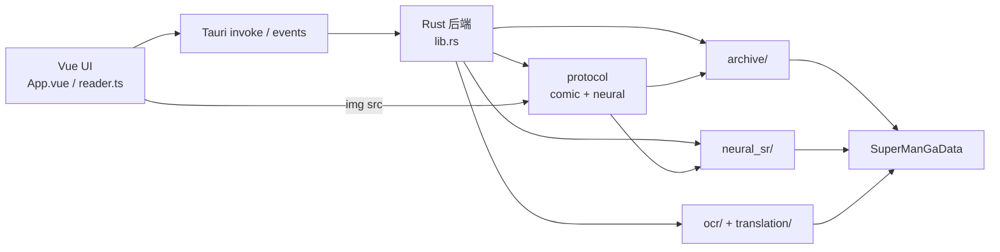
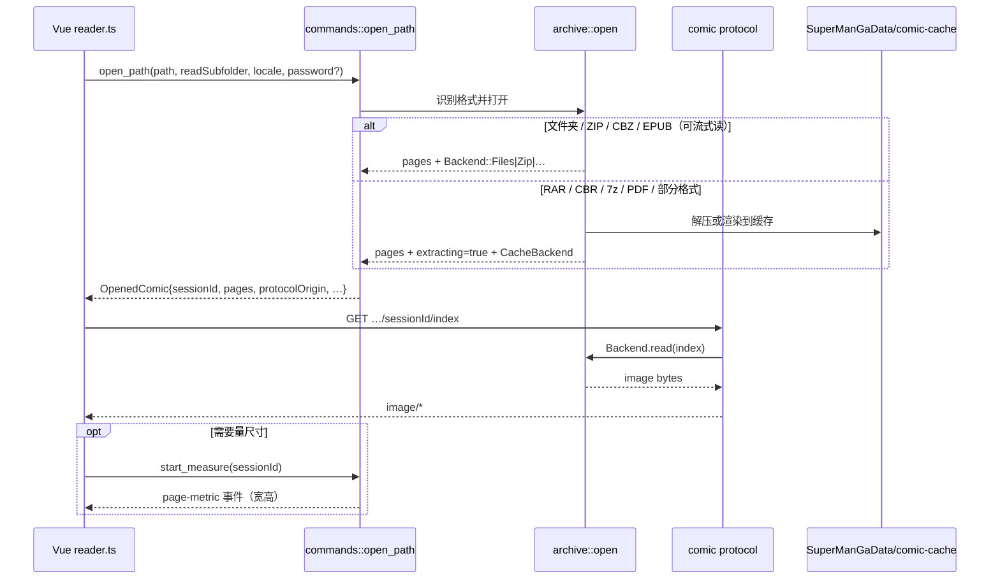
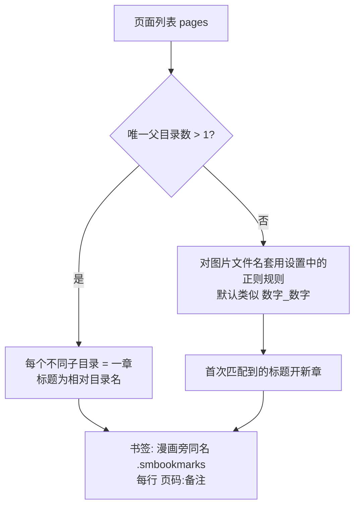
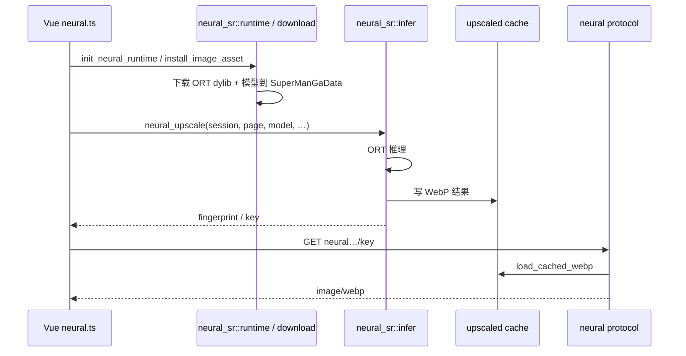
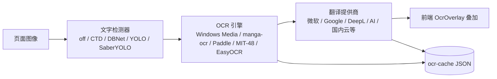
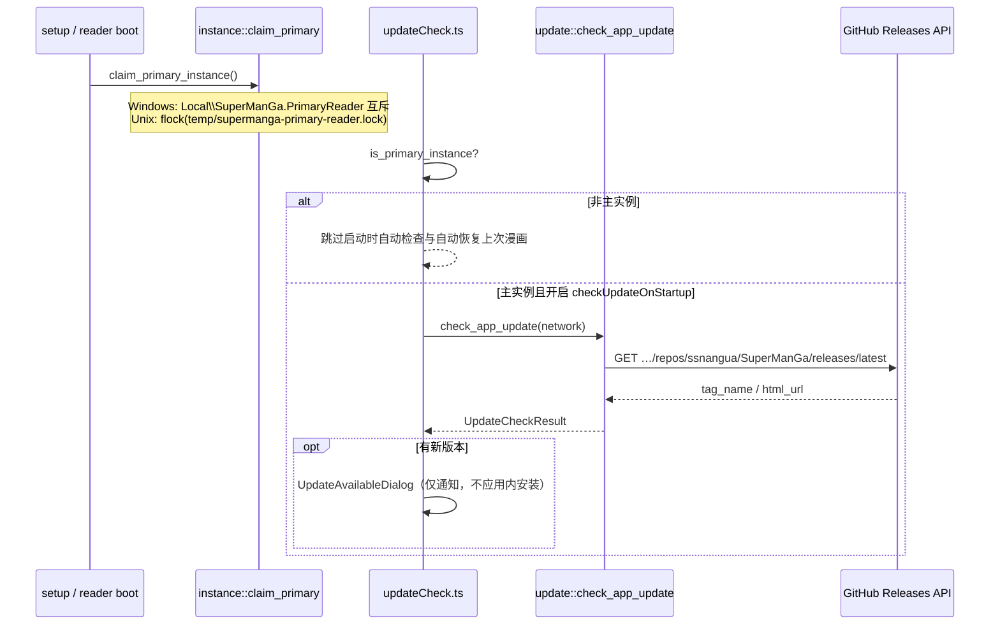
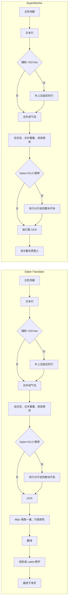

# 开发文档

本文面向开发与维护。用户向说明见 [README.md](../README.md)。

---

## 目录

1. [概述](#1-概述)
2. [开发 / 构建 / 发布](#2-开发--构建--发布)
3. [目录结构](#3-目录结构)
4. [架构与模块](#4-架构与模块)
5. [跨平台差异](#5-跨平台差异)
6. [国际化（i18n）](#6-国际化i18n)
7. [附录：格式支持与许可](#7-附录格式支持与许可)
8. [附录：文字检测器导出](#8-附录文字检测器导出)
9. [附录：与 Saber-Translator 的差异](#9-附录与-saber-translator-的差异)

---

## 1. 概述

SuperManGa 是 **Vue 3 + Tauri 2** 的桌面应用：一次打开一个文件夹、压缩包或电子书，按条漫纵向滚动，或单页 / 双页翻页；可选神经网络超分、翻译（文字检测 → OCR → 在线翻译）。

| 层 | 技术 |
|---|---|
| 前端 | Vue 3、Vite、TypeScript、vue-i18n |
| 桌面壳 | Tauri 2、Rust |
| 原生依赖 | pdfium（按平台拉取）、ONNX Runtime（按需下载）、UnRAR（RAR/CBR） |

图片通过自定义协议按页返回（Windows / Android：`http://comic.localhost`；其他平台：`comic://localhost`）。超分结果同理走 `neural` 协议。

文件关联、右键菜单、WebView2 检测、Windows Media OCR 等为 Windows 专用能力。主实例互斥在各桌面平台均有。

---

## 2. 开发 / 构建 / 发布

### 2.1 前置条件

| 依赖 | 说明 |
|---|---|
| **Node.js** | 版本见仓库根目录 [`.node-version`](../.node-version)（当前为 `22.22.2`） |
| **Rust** | stable 工具链；与 Tauri 2 兼容 |
| **Windows** | Visual Studio **C++ 生成工具**；**WebView2** Evergreen（Win10/11 通常已带；便携版启动前会检测，缺失则原生提示并打开微软下载页） |
| **Linux** | `webkit2gtk-4.1` 及构建依赖（见 CI：`libwebkit2gtk-4.1-dev`、`libayatana-appindicator3-dev`、`librsvg2-dev`、`patchelf` 等） |
| **macOS** | Xcode CLT；使用系统 WKWebView |

### 2.2 本地开发

```bash
npm install
npm run fetch:pdfium   # 下载本机平台 pdfium（Win: pdfium.dll / macOS: libpdfium.dylib / Linux: libpdfium.so）
npm run dev
```

- `npm run dev` 会先跑 `predev`（`fetch-pdfium.mjs --optional`），拉取失败不阻断。
- 加密 PDF / PDF 栅格化依赖 pdfium；发版时 `beforeBuildCommand` 与 CI 会按目标平台拉取并打进包。
- 开发服务器默认 `http://localhost:1420`（见 `tauri.conf.json` 的 `devUrl`）。

**浏览器演示（不读本地文件）：**

```
http://localhost:1420/?demo=1
```

用程序生成的 24 页演示界面与阅读交互。

### 2.3 本机构建与 Windows 便携包

```bash
npm run build         # 各平台：tauri build --no-bundle（不打安装包）
npm run build:win     # Windows：编译 + 打 portable zip
npm run build:mac     # macOS：打 dmg（交叉编译可加 -- --target …）
npm run build:linux   # Linux：打 deb
```

| 命令 | 作用 |
|---|---|
| `build` | 编译前端 + Rust，`--no-bundle`，**跨平台可用** |
| `build:win` | 仅 Windows：`build` 后再把 `supermanga.exe`（+ pdfium）打进 `SuperManGa-*-windows-x64.zip` |
| `build:mac` | 仅 macOS：`tauri build --bundles dmg` |
| `build:linux` | 仅 Linux：`tauri build --bundles deb` |

Windows 产物：

```
src-tauri/target/release/bundle/portable/SuperManGa-*-windows-x64.zip
└── SuperManGa-*-windows-x64
    ├── SuperManGa.exe
    └── pdfium.dll
```

**Windows：** 首次运行在 exe 同级创建 `SuperManGaData/`（不可写则回退系统应用数据目录）。

**macOS / Linux：** 默认写在系统应用数据目录下的 `SuperManGaData/`（不写在 `.app` 内，避免升级时丢数据）。

### 2.4 GitHub Actions 发版

工作流：[`.github/workflows/release.yml`](../.github/workflows/release.yml)

1. 用 npm 升版本（会改 `package.json`，并经 `version` 钩子同步 `Cargo.toml`、`tauri.conf.json` 和 README 下载链接，再提交并打 `v*` tag）：

   ```bash
   npm version patch   # 或 minor / major
   git push origin HEAD --follow-tags
   ```

   若只改了 `package.json`、尚未打 tag：`npm run sync-version`。

2. 推送 `v*` tag 时，CI 校验 tag 与三处版本一致，再分别构建并上传产物：

| 平台 | 产物 | 最低系统版本 |
|---|---|---|
| Windows x64 | `SuperManGa-*-windows-x64.zip`（便携版） | Windows 10+ |
| macOS arm64 | `SuperManGa-*-macos-arm64.dmg` | macOS 11+ |
| macOS x64 | `SuperManGa-*-macos-x64.dmg` | macOS 10.15+ |
| Linux arm64 | `SuperManGa-*-linux-arm64.deb` | Ubuntu 22.04+ / Debian 12+ |
| Linux x64 | `SuperManGa-*-linux-x64.deb` | Ubuntu 22.04+ / Debian 12+ |

也可在 Actions 里 `workflow_dispatch` 手动跑 **Release**，只拿构建产物、不发 GitHub Release。

### 2.5 macOS 安装与使用

当前发版未使用 Apple Developer ID 签名与公证，启动时可能会被 Gatekeeper 拦截（「无法验证开发者」）。

`tauri.conf.json` 里 `bundle.macOS.signingIdentity` 为 `"-"`（ad-hoc），`hardenedRuntime` 为 `false`，CI 也不做 notarize。下载的 `.dmg` / `.app` 会带 `com.apple.quarantine`。

**用户侧临时处理：**

1. 打开 **系统设置 → 隐私与安全性**，滑到下方点 **仍要打开**（再确认一次）。
2. 或对 `.app` **右键 → 打开**（比直接双击更容易放行）。
3. 或去掉隔离标记后再开：`xattr -dr com.apple.quarantine /Applications/SuperManGa.app`（路径按实际安装位置改）。

**彻底解决（维护者）：**

加入 [Apple Developer Program](https://developer.apple.com/programs/)，用 **Developer ID Application** 证书签名，打开 `hardenedRuntime`，并对 `.app` / `.dmg` 做 **notarize + staple**；在 CI 配置相应证书与 `APPLE_ID` / 团队 ID / app-specific password（或 API key）密钥。

未完成前，文档与 FAQ 需说明上述临时步骤。

### 2.6 Linux 安装与使用

`.deb` 在 Ubuntu 22.04（glibc **2.35**）上构建，以便跑在 Debian 12 / Ubuntu 22.04+。

在 `.deb` 所在目录执行（`./` 不可省略）：

```bash
# x64
sudo apt install ./SuperManGa-*-linux-x64.deb

# arm64
sudo apt install ./SuperManGa-*-linux-arm64.deb
```

或：`sudo dpkg -i SuperManGa-*-linux-*.deb`，缺依赖时再 `sudo apt-get install -f`。装好后应用菜单可启动，或运行 `supermanga`。

### 2.7 ONNX 运行时与模型

用 [`tools/pack-data/`](../tools/pack-data/) 打包运行时与模型，会输出一堆 `{stem}-v{ver}.zip` 和一个清单文件 `manifest.json`，统一放在 GitHub Release tag **`data`**。

下载到本机目录为：

```
数据目录/SuperManGaData/data/
├── {stem}-v{ver}/
└── manifest.json
```

清单条目为 `{ version, bytes, sha256 }`：
- `version`：资源版本
- `bytes`：供界面显示下载大小
- `sha256`：在下载后校验坏包

应用内置 seed 清单，设置 → 通用 →「启动时获取最新资源清单」（`fetchDataManifestOnStartup`，默认开）：
- 开启：会在应用启动后，在后台短超时静默获取
- 关闭：可手动拉取

运行时选型（按平台下载，stem 形如 `runtime-{os}-{arch}-{flavor}`，例如 `runtime-macos-arm64-cpu`）：

| 本机条件 | 行为 |
|---|---|
| 有匹配本机的 `runtime-*-cuda*-v…` | 选用 CUDA ORT，可用则走 GPU EP |
| 无 CUDA / 无 GPU 包，但有本机 `runtime-*-cpu-v…` | 自动选用 CPU，显示已就绪 |
| 只有 CUDA 包、没有本机 CPU 包 | 显示「初始化」，需下载 CPU 包 |

- ORT CUDA 包仅 Windows/Linux x64
- macOS 用同一套 CPU 包，推理时自动挂 **CoreML** EP（Apple GPU / Neural Engine）
- macOS Intel（x64）使用官方最后一版预编译 **ORT 1.23.0**（`runtime-macos-x64-cpu`），其余平台为 1.30。
- ONNX 模型包不分平台

### 2.8 Windows 完整离线包

若希望**解压即可使用超分 / 翻译**，可打完整离线包（含程序 + ONNX 运行时 + 所有模型）：

```bash
# 先有程序包（或至少有 target/release/supermanga.exe）
npm run build:win          # 若 portable 已存在可跳过
# 可选：本地打好数据包
cd tools/pack-data && python pack.py && cd ../..

npm run bundle:win-full
# 产出：
#   src-tauri/target/release/bundle/portable/SuperManGa-*-full-windows-x64.zip
```

完整包结构：

```
SuperManGa-*-full-windows-x64/
├── SuperManGa.exe
├── pdfium.dll
└── SuperManGaData/data/   # manifest + runtime/detector/ocr/neural 版本目录
```

复用规则：

- 已有 `…/portable/SuperManGa-*-windows-x64.zip` → **不重新构建/打包程序**；没有 zip 但有 `supermanga.exe` 时只跑 `pack-portable.mjs`
- 已有 `tools/pack-data/data/{pack}.zip`（及同目录 `manifest.json`）→ **不从 GitHub 下该包**；缺的才回退 Release tag `data`

完整离线包须带上本机 **CPU** flavor。

---

## 3. 目录结构

```
SuperManGa/
├── package.json              # name: supermanga
├── .node-version
├── index.html / log.html     # Vite 多页入口（根目录为 Vite/Tauri 惯例）
├── README.md                 # 中文用户说明（仓库首页）
├── docs/
│   ├── README_en.md / README_ja.md / README_ko.md
│   ├── DOCS_zh.md / DOCS_en.md
│   └── screenshot.jpg
├── public/
│   └── icon.png
├── scripts/
│   ├── fetch-pdfium.mjs
│   ├── pack-portable.mjs
│   ├── bundle-win-full.mjs
│   └── check-i18n.mjs
├── tools/                    # 离线工具（不打进安装包）
│   ├── pack-data/            # 打 data Release zip + manifest
│   └── export-detectors/     # 文字检测器 → ONNX（供 pack-data）
├── src/                      # Vue 前端
│   ├── main.ts               # 主窗口入口
│   ├── log-main.ts / LogApp.vue
│   ├── App.vue
│   ├── reader.ts             # 阅读状态、打开漫画、设置、快捷键等核心逻辑
│   ├── i18n.ts               # 五语言文案
│   ├── components/           # UI（阅读视图、设置、OCR/神经资源对话框等）
│   ├── composables/
│   ├── assets/
│   └── lib/
│       ├── ocr/              # 检测器/引擎 catalog、可用性、翻译队列
│       ├── render/           # 神经超分、重采样 worker、纹理限制等
│       ├── translation/      # 翻译提供商类型、默认值、字体
│       ├── chapters.ts / chapterRules.ts / bookmarks.ts
│       └── updateCheck.ts
└── src-tauri/
    ├── tauri.conf.json       # productName: SuperManGa
    ├── Cargo.toml            # package name: supermanga
    ├── capabilities/
    ├── icons/
    ├── resources/pdfium/     # fetch 产物（gitignore 常见）
    └── src/
        ├── main.rs / lib.rs  # 入口：协议注册、invoke、setup
        ├── commands.rs       # open_path、书签、系统信息等
        ├── open.rs           # 启动参数 / 打开队列
        ├── protocol.rs       # comic / neural URI scheme 响应
        ├── state.rs
        ├── app_cache.rs      # SuperManGaData 根路径与子目录
        ├── secrets.rs        # 翻译密钥（keyring + 文件回退）
        ├── instance.rs       # 主实例互斥（Win 互斥 / Unix flock）
        ├── macos_dock_menu.rs # macOS Dock 右键「打开新窗口」
        ├── windows_jumplist.rs # Windows 任务栏 Jump List「打开新窗口」
        ├── linux/supermanga.desktop # deb Desktop Action「打开新窗口」
        ├── update.rs         # GitHub Releases 更新检查
        ├── association.rs    # 文件关联 / 右键菜单（Windows）
        ├── webview2_check.rs # WebView2 检测（Windows only）
        ├── window_state.rs   # 窗口几何恢复；Windows HWND 图标
        ├── system_fonts.rs
        ├── app_log.rs
        ├── ocr_assets.rs
        ├── archive/          # 文件夹 / zip / rar / 7z / epub / pdf / mobi
        ├── data_packs.rs / neural_sr/  # data Release 清单、ORT、推理
        ├── ocr/              # 检测器 + 各 OCR 引擎
        └── translation/      # 在线翻译提供商
```

#### 辅助脚本

| 脚本 | 作用 |
|---|---|
| [`scripts/fetch-pdfium.mjs`](../scripts/fetch-pdfium.mjs) | 按本机或 `PDFIUM_TARGET` / `TAURI_ENV_TARGET_TRIPLE` 下载 pdfium 到 `src-tauri/resources/pdfium/` |
| [`scripts/pack-portable.mjs`](../scripts/pack-portable.mjs) | 将 `target/release/supermanga.exe` 打成 Windows portable zip，并附带 pdfium |
| [`scripts/bundle-win-full.mjs`](../scripts/bundle-win-full.mjs) | 合并 portable + 数据包 → `SuperManGa-*-full-windows-x64.zip`（优先本地 pack-data / 已有 portable） |
| [`scripts/check-i18n.mjs`](../scripts/check-i18n.mjs) | 检查 `src/i18n.ts` 各语言键一致，并扫描源码中未声明的 `$t` / `t(` 键 |
| [`scripts/sync-version.mjs`](../scripts/sync-version.mjs) | 把 `package.json` 的 version 同步到 Cargo.toml、Cargo.lock、tauri.conf、README；`npm version` 会自动跑 |

常用 npm scripts：`dev`、`fetch:pdfium`、`build:win`、`build:mac`、`build:linux`、`bundle:win-full`、`sync-version`、`preview`。

---

## 4. 架构与模块

### 4.0 总览



---

### A) 打开漫画流程

UI 调用 `open_path` → Rust 按扩展名选择 backend → 列出页面 → 必要时后台解压 / 栅格化 → 前端用 `protocol_origin` + 页索引加载图片。尺寸可异步 `start_measure` 补全。



**支持打开：** 文件夹；`.zip` / `.cbz`；`.rar` / `.cbr`；实体 `.7z`；`.epub`；`.pdf`；无 DRM 的 `.mobi` / `.azw3` / `.azw`（不支持 KFX）。RAR/CBR/7z/PDF 等会解到或渲染到本地缓存，并上报解压进度；已就绪的页可先看。

---

### B) 阅读模式与章节

| 模式 | 说明 |
|---|---|
| `scroll` | 条漫纵向连续滚动；视口附近挂图；方向键上下按步长滚动 |
| `single` | 单页翻页 |
| `double` | 双页；可隔离封面；LTR / RTL；适应宽 / 高 / 整页 |

章节划分（前端 [`src/lib/chapters.ts`](../src/lib/chapters.ts)）：



书签由 Rust `load_bookmarks` / `save_bookmarks` / `delete_bookmarks` 读写漫画路径旁的 `.smbookmarks` 文件。

---

### C) 神经网络超分（Neural SR）

按需下载 ONNX Runtime 与模型包 → `neural_upscale` 推理 → 结果写入 `upscaled/` → 前端通过 `neural` 协议读 WebP 缓存。



相关模块：`neural_sr/{download,runtime,infer,cache,results,models,ort_env,cuda}`；
前端 `lib/render/neural.ts`、`NeuralAssetsDialog`、`NeuralSettingsPanel`。
协议 origin：Windows/Android 为 `http://neural.localhost`，其余为 `neural://localhost`。

---

### D) OCR + 翻译管线



- **检测器**（可选辅 YOLO 合并、SaberYOLO OBB 精修）：权重按清单从 Release `data` 下载到 `SuperManGaData/data/`。
- **OCR**：Windows Media OCR 仅 Windows，其余为跨平台通用 ONNX。
- **翻译**：密钥优先 OS keyring，失败则写入 `SuperManGaData/secrets/` 应用绑定加密文件。
- 前端可开启「全书预翻译」或仅当前页/邻页；全书预翻译/预超分的后台队列均从当前页向两侧辐射（先往后再往前）。结果叠在 `OcrOverlay`。

入口命令：`ocr_translate_page`、`cancel_ocr_translate`、`translate_text_cmd`。

---

### E) 设置与 SuperManGaData 布局

**发布版默认根目录：**  
- Windows：`<exe 目录>/SuperManGaData`（若不可写则回退 OS app data）  
- macOS / Linux：`<OS app data>/SuperManGaData`  

**调试时** 一律 `<OS app data>/SuperManGaData`。  
自定义路径记录在系统 app data 下的 `data-root.json`（定位器始终在固定 OS 目录）。

```
SuperManGaData/
├── reader.json          # 设置 / 窗口状态（plugin-store）
├── secrets/             # 翻译 API 密钥文件回退
├── comic-cache/         # 压缩包解压 / PDF 渲染页
├── neural-sr/           # 神经模型包
├── upscaled/            # 超分结果
├── runtime/             # ONNX Runtime 动态库
├── ocr-assets/          # OCR / 检测器模型包
├── ocr-cache/           # 每页 OCR+翻译 JSON
└── pdfium/              # 运行时可用的 pdfium（若单独存放）
```

`app_cache.rs` 提供 `get_cache_dir`、`set_cache_dir`、`migrate_cache_dir` 等。设置 UI 在 `SettingsDialog` 等组件；`reader.ts` 持有运行时 settings 对象。

---

### F) 更新检查（仅主实例）



手动「检查更新」不强制主实例门闩；启动静默检查与「自动打开上次漫画」共用主实例门闩。

---

## 5. 跨平台差异

| 能力 | Windows | macOS | Linux | 备注 |
|---|:---:|:---:|:---:|---|
| 阅读核心（打开 / 翻页 / 章节 / 书签） | ✓ | ✓ | ✓ | |
| `comic` / `neural` 协议 | ✓ | ✓ | ✓ | **Origin 不同**：Win/Android 为 `http://*.localhost`；其他为 `scheme://localhost` |
| pdfium | ✓ | ✓ | ✓ | `fetch-pdfium` / CI 按目标 triple 拉取 |
| 系统字体列表 | ✓ | ✓ | ✓ | |
| 多数 OCR（manga-ocr、Paddle、MIT-48、EasyOCR） | ✓ | ✓ | ✓ | 需 ORT + 资源包 |
| ORT / 神经超分 | ✓ | ✓ | ✓ | CUDA 等视平台与资源 |
| **WebView2 启动检测** | ✓ | — | — | 便携版无安装器引导；缺失则退出 |
| **文件关联 / 右键菜单** | ✓ | — | — | 设置内注册；`association.rs` |
| **Windows Media OCR** | ✓ | — | — | `ocr/win_ocr.rs` |
| 主实例互斥 | ✓ | ✓ | ✓ | Win 互斥 / Unix flock；仅主实例自动恢复上次漫画 |
| **启动器再开新实例** | ✓ | ✗* | ✓† | Win 开始菜单 / Linux 应用菜单常再启进程；\*macOS 启动台与 Dock 左键同走 `'rapp'` 聚焦；†任务栏仍多聚焦 |
| 任务栏/Dock「打开新窗口」 | ✓ | ✓ | ✓ | Win Jump List / macOS Dock 菜单 / Linux `.desktop` Actions → 再启进程 |
| **HWND 原生窗口图标** | ✓ | — | — | `window_state::apply_native_window_icons` |
| **portable zip 脚本** | ✓ | — | — | `pack-portable.mjs`；mac/Linux 用 dmg / deb |
| keyring 密钥 | ✓ | ✓ | ✓ | `keyring` 启用各平台原生后端；失败则 **文件加密回退**（便携可复制） |

---

## 6. 国际化（i18n）

界面语言：`zh-CN`、`zh-TW`、`en`、`ja`、`ko`（定义于 [`src/i18n.ts`](../src/i18n.ts)）。系统语言标签会映射到上述集合，无法匹配时回退 `en`。

修改文案后请运行：

```bash
node scripts/check-i18n.mjs
```

脚本会：

1. 校验五种 locale 的 key 集合一致；
2. 扫描 `src/` 中 `$t('…')` / `t('…')` 是否都有定义。

翻译目标语言列表与 UI locale 不完全相同（OCR / 翻译可选用更多内容语言标签）。

---

## 7. 附录：格式支持与许可

### 阅读格式摘要

- 文件夹、`.zip`、`.cbz`、`.epub`：打开即可翻页；EPUB 按 spine 抽图（偏固定版式漫画），几乎无图的文字 EPUB 会提示找不到图片。
- `.rar`、`.cbr`、实体 `.7z`、`.pdf`：解压 / 渲染到缓存并显示进度。
- `.mobi` / `.azw3` / `.azw`：无 DRM 按资源区抽图；有 DRM 明确拒绝。不支持 KFX。

解压类进度在底部进度条用 warning 色段显示（优先级：超分/翻译 → 解压 → 量尺寸）。

### UnRAR

读取 RAR / CBR 时使用 [unrar](https://www.rarlab.com/) 官方解压库（经 `unrar-ng`，仅解压）。
UnRAR 许可条件与本项目代码分开，不能视为项目许可证的一部分。说明见 [RARLAB](https://www.rarlab.com/license.htm)。

### PDF 与 pdfium

- 无 pdfium
  - **未加密** 且 **关闭栅格化**：直接抽图（lopdf 按页序，再字节扫描） ← 「路径 A」
  - **已加密** 或 **开启栅格化**：尝试下载 pdfium，成功后走 B1 或 B2，失败则报错（不静默改走抽图）
- 有 pdfium
  - **开启栅格化**：走整页栅格化（缓存键 `pdf-r`） ← 「路径 B1」
  - **关闭栅格化**：导出内嵌原始图片（缓存键 `pdf-i`） ← 「路径 B2」

**栅格化与加密均强依赖 pdfium**，下载失败则报错，不静默改走「路径 A」抽图（仅「无 pdfium + 未加密 + 关闭栅格化」才走 A）。

缓存键区分 `pdf-r` / `pdf-i`，切换开关会清另一模式缓存，当前正在看的 PDF 会取消旧任务并按新路径重开。

B1 后台全书预渲，打开时用 MediaBox 先填尺寸，解压队列从当前页向两侧辐射（先往后再往前）。

---

## 8. 附录：文字检测器导出

用 [`tools/export-detectors`](../tools/export-detectors) 导出 ONNX → [`tools/pack-data`](../tools/pack-data) 打成 `detector-*-v*.zip` → 上传 Release tag **`data`**。

需要 Python 3.10+；源权重本仓库不收录。

<details>
<summary>如何取得源权重</summary>

- **DBNet**（`detect-20241225.ckpt`）：可从 manga-image-translator 下载 [detect-20241225.ckpt](https://github.com/zyddnys/manga-image-translator/releases/download/beta-0.3/detect-20241225.ckpt)。或在 [Saber-Translator](https://github.com/MashiroSaber03/Saber-Translator) 的 `models/default/` / [BallonsTranslator](https://github.com/dmMaze/BallonsTranslator) 的 `data/models` 获取。
- **YSGYolo**（`ysgyolo_*.pt`）：Hugging Face [`YSGforMTL/YSGYoloDetector`](https://huggingface.co/YSGforMTL/YSGYoloDetector)。
- **SaberYOLO**（`saber_yolo.pt`）：从 [Saber-Translator Releases](https://github.com/MashiroSaber03/Saber-Translator/releases) 的 `models.zip` 分卷或完整安装包的 `models/saber_yolo/` 获取。
- **CTD**：`pack-data` 直接下载 MIT 公开 ONNX，无需本地导出。

</details>

```bash
cd tools/export-detectors
pip install -r requirements.txt

python export_yolo.py --weights path/to/ysgyolo_*.pt --out out/ysgyolo.onnx
python export_yolo.py --weights path/to/saber_yolo.pt --out out/saber_yolo.onnx --obb
python export_default_dbnet.py --weights path/to/detect-20241225.ckpt --out out/detect-20241225.onnx --saber-root path/to/Saber-Translator-main

cd ../pack-data
python pack.py --only detector
# 将 data/detector-*-v*.zip 与 manifest.json 上传到 Release tag `data`
```

## 9. 附录：与 Saber-Translator 的差异

检测与气泡合并移植自 [Saber-Translator](https://github.com/MashiroSaber03/Saber-Translator) 的 `src/core/detector`（CTD / DBNet / YSGYolo / SaberYOLO、行合并、阅读顺序、SaberYOLO 二次拆分）。实现在 [`src-tauri/src/ocr/detector`](../src-tauri/src/ocr/detector)。Saber 用像素和 shapely；这里的框是页面归一化四边形，分割里「5 像素」一类固定阈值是近似。

两边从主检测器到 SaberYOLO 精修是同一条可选路径。「启用辅助 YSGYolo 检测」默认关；主检测器已是 YSGYolo 时不再叠一次。Saber 的检测器只出框，精确文字掩膜另跑一遍 Default（DBNet），给后面的擦字用。



| 环节 | Saber-Translator | SuperManGa |
|---|---|---|
| 主检测器 | Default（DBNet）、CTD、YSGYolo、SaberYOLO | 同一组，id 为 `dbnet` / `ctd` / `yolo` / `saber_yolo`；可关 |
| 辅助 YSGYolo | 可选，默认关。置信度 0.4。主检测没盖住的框补上；一个辅助框包住若干小框且面积够大时，用它换掉那些小框 | 设置项「启用辅助 YSGYolo 检测」，规则与默认相同 |
| 行合并 | 像素距离；可选按边长比断开过远的边（默认阈值 0，等于不切） | 同一套合并与最小生成树分割；没有边长比开关 |
| SaberYOLO 精修 | 参考框中心落在气泡内，或与气泡重叠达到阈值，才参与拆分；有行分不进去就放弃这一块 | 控制流相同。NMS 之后多一步：一个框若包住至少两个更小的框，丢掉这个大框 |
| MangaOCR | 每个气泡外接矩形缩成 224，官方 `manga-ocr` 认一次 | 同样整框一次；ONNX 编码器 + 解码器贪心 |
| 48px | 每行透视到高 48，beam search（k=5）。颜色头接在解码隐状态上 | `ocr-48px-ctc.onnx`，CTC 一次前向。导出里带颜色通道时，字色从同一次输出里读 |
| 其他识别 | Paddle、百度 OCR、PaddleOCR-VL、视觉模型 | Paddle（有气泡则按行）、Windows Media OCR、EasyOCR。没有百度 OCR、VL、视觉 OCR |
| 字色 | 独立步骤：每行再跑一遍 48px，丢掉文字，只平均前景色和背景色。`useAutoTextColor` 打开才写进气泡 | MangaOCR / Paddle / 系统 OCR / EasyOCR 在框边采样，暗的当墨、亮的当纸。仅 MIT-48px 在颜色头有结果时改用模型字色。「文字颜色 → 自动识别」默认关，浮层用设置里的固定颜色 |
| 译文 | 写入气泡，可校对；再擦掉原文并重画 | 在线翻译后叠在阅读器上。没有 LaMA 修复，也不导出擦干净的页 |

